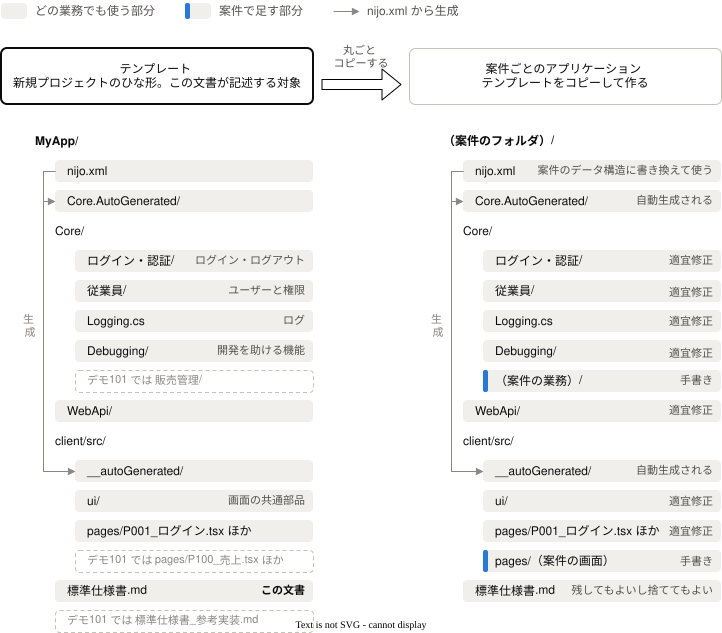
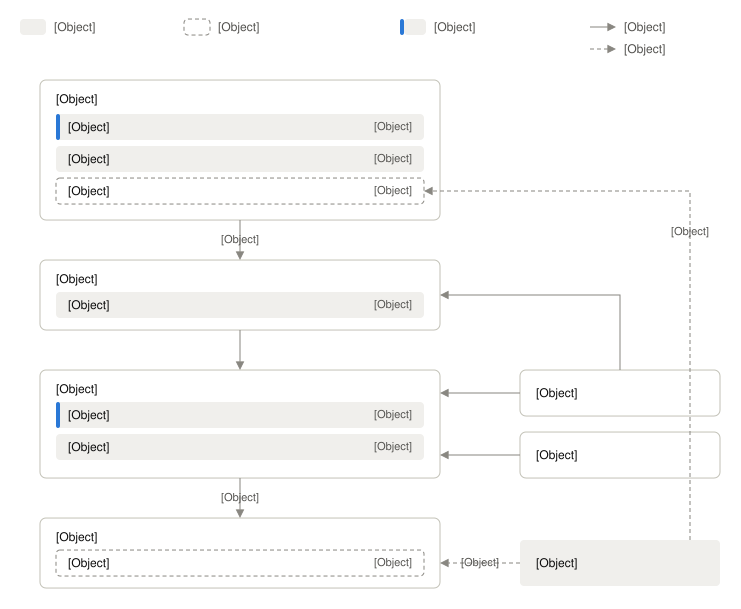
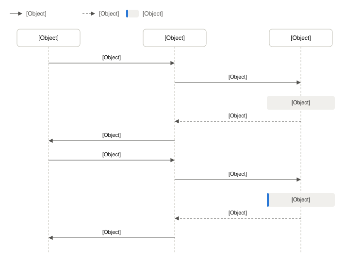
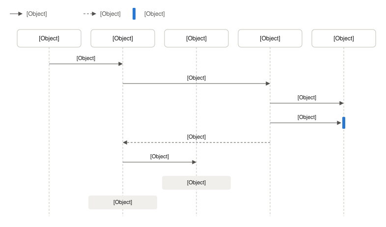
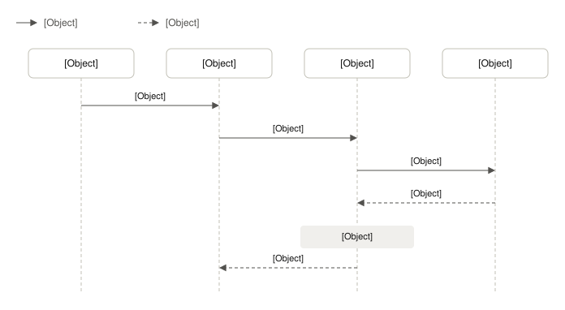
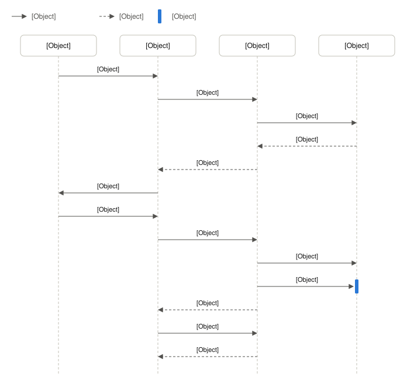
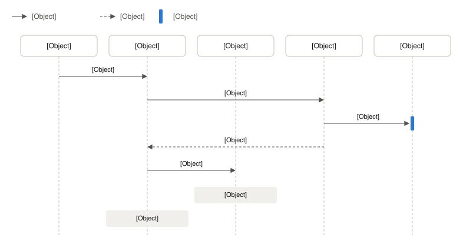
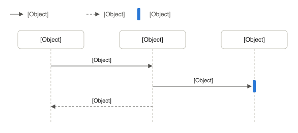

# 標準仕様書

nijo は、アプリケーションのデータ構造と処理を XML ファイル（nijo.xml）に定義し、そこから C# と TypeScript のコードを自動生成するツールである。生成されたコードの上に手書きのコードを追加して、画面・API・DB をもつ業務アプリケーションを作る。

デモ101は、nijo で作った販売管理システムのデモである。デモ101から販売管理に固有の部分を取り除いたものを、新規プロジェクトのひな形（以下、テンプレート）として配布している。新しいアプリケーション（以下、案件）は、次の図のように、テンプレートを丸ごとコピーして作り始める。

案件は、テンプレートに入っているどの業務でも使う部分を必要に応じて修正し、業務のフォルダと画面を手書きで追加する。この文書は、テンプレートのうち業務に依存しない部分がどう振る舞うかを記述した仕様書である。

---

## 1. この文書について

### 1.1 この文書の性格と読者

- この文書には、コピーした時点のテンプレートの共通の仕様を書く。この文書で「テンプレート」と書くのは、コピーした時点の状態のことである。
- この文書もテンプレートと一緒にコピーされる。コピーした後は、案件の文書として残して保守してもよいし、捨ててもよい。案件はテンプレートのどこを書き換えてもよく、この文書を残す場合は、書き換えに合わせてこの文書も書き換える。
- この文書は、テンプレートの説明（何が入っていて、どこまで対応していて、どう変えるか）と、案件の共通の仕様の2つを兼ねている。残した場合、案件がテンプレートを書き換えていくと、「テンプレートでは〜」という記述は古くなっていく。案件は、実際にどれだけ古くなったかを見たうえで、テンプレートの説明の部分を切り離すか、削るか、書き換えて残すかを決める必要がある。
- 読者は、テンプレートの採用を検討する人と、コピーした後にアプリケーションとこの文書を保守する人である。
- 業務のデータ構造・画面・処理は扱わない。それらは案件ごとに nijo.xml と案件の文書で定める。
- 販売管理業務の実装の見本は、デモ101にだけある別ファイル `標準仕様書_参考実装.md` にまとめている。
- 開発環境の準備と開発の始め方は、README に書いている。

### 1.2 各章の書き方

3章以降は、関心事ごとに1章を立てる。各章では、冒頭に概要を書き、続けて次の節のうち必要なものを置く。

| 節 | 内容 |
|---|---|
| 仕様 | テンプレートの振る舞いを、仕様項目の表で書く（1.3） |
| 限界 | 仕様の振る舞いでは足りなくなる条件と、足りないときに取れる手段 |
| よくある変え方 | 案件でよく変える部分について、変え方と、変えたときに影響が及ぶ範囲 |
| 処理の流れ | 処理のきっかけごとの流れを、図と、図の下の補足で示す |
| 仕組み | 内部の実装の考え方。仕様ではなく、関係する仕様が保たれていれば変えてよい |

概要には、その章が何を扱うかを書く。案件に合わせて作り直すことを想定しているものなど、その章に固有の事情があれば、それも書く。

テンプレートを変えるときの影響の大きさは、次の2つで分かる。

- 実現手段の列（1.3）：「nijo」の仕様は、nijo の側の対応がなければ変えられない。
- 各章の「よくある変え方」：変えたときに影響が及ぶ範囲を書いている。

このほか、章の内容を説明するための節（一覧の表など）を置くことがある。

まだ実装していない仕様は、確認方法に「（未実装）」を付ける（例：テスト（未実装））。章の全体が未実装のときは、章の見出しにも付ける。実装済みの仕様の一部だけが未実装のときは、備考に「未実装：」に続けてその部分を書く。「未実装」で検索すれば、対象の箇所がすべて分かる。

### 1.3 仕様項目の書き方と属性

仕様は、1行に1件ずつ、次の列をもつ表で書く。

| 列 | 内容 |
|---|---|
| ID | 仕様の識別子。他の章からは、この ID で参照する |
| 仕様 | テンプレートの振る舞いを「〜する」の形で、1件につき1つの事柄を書く |
| 実現手段 | その振る舞いをどこで決めているか（下表） |
| 確認方法 | 振る舞いを確認する方法。テスト（自動テストがある）、実演（動かして見る）、検査（ソースや定義を読む）のいずれか |
| 備考 | 根拠、関係する仕様 |

実現手段：

| 実現手段 | 意味 | 変えたいとき |
|---|---|---|
| nijo | nijo が生成するコードで決まっている | nijo の側の対応が必要になる。nijo のバージョンアップで変わることがある |
| nijo.xml | nijo.xml の指定で切り替えられる | nijo.xml の指定を変えて再生成する |
| 手書き | 手書きのコードで決まっている | コードを直接書き換える |

### 1.4 用語

| 用語 | 意味 |
|---|---|
| nijo.xml | アプリケーションのデータ構造と処理を定義するファイル。データ構造の正本 |
| 再生成 | nijo.xml を変えた後、nijo のコマンドラインツールでコードを生成し直すこと |
| データモデル | nijo.xml で、DB に保存すると指定したデータ構造（`IsStored`）。テーブルと登録・更新・削除の処理が生成される |
| クエリモデル | nijo.xml で、検索できると指定したデータ構造（`IsQueryable`）。検索条件・検索結果の型と検索処理が生成される |
| コマンド | nijo.xml で定義する、更新などの処理。API と処理の枠が生成される |
| カスタム属性 | nijo.xml の項目に付ける、アプリケーション独自の属性。テンプレートには「最大長」「金額項目」「数量」「マスキング」がある |
| Ref | 他のデータ構造を参照するときに使う、参照に必要な最低限の項目だけをもつデータ構造 |
| MapToView | クエリモデルの検索結果を、DB のビューから取得するようにする nijo.xml の指定 |
| 汎用参照テーブル | 区分値など、件数が少なく種類の多い参照用のデータを、データ構造ごとにテーブルを作らず1つのテーブルにまとめて保存する仕組み。データ構造ごとに見えるよう、DB のビューを作る |
| アプリケーションサービス | 業務ロジックを書くクラス。画面からの API、単体テスト、ジョブ、バッチから呼ばれる |
| 呼び出しの共通の入出力 | 処理の呼び出し1回ごとに、呼び出し元が作って処理に渡し、処理の後に中身を読む情報。入力チェックだけを行うかの指定と、確認メッセージをもつ |
| 確認メッセージ | 更新の前に利用者に了承を求めるメッセージ（API-005） |
| マイグレーション | DB のテーブル定義の変更を、変更1回ごとに記録して適用する仕組み |
| ユーザー | ログインする人。テンプレートでは、nijo.xml のデータ構造「従業員」で表す |
| 案件 | テンプレートをコピーして作る、個々のアプリケーション |

---

## 2. 概要

### 2.1 使っている技術

主な技術とメジャーバージョンだけを書く。詳細なバージョンは各プロジェクトの定義を正とする。

| 分類 | 技術 |
|---|---|
| サーバー | .NET 10、ASP.NET Core |
| DB アクセス | Entity Framework Core 10 |
| 開発環境の DB | SQLite |
| ログ | NLog 6 |
| API の一覧の表示 | Swagger（開発環境だけ） |
| 画面 | React 19、TypeScript 5、React Router 7、React Hook Form 7、Tailwind CSS 4、Vite 7 |
| テスト | NUnit 4（サーバー）、Vitest 3（画面） |
| 手順のスクリプト | bash（リリース用のビルドだけは Windows のバッチファイル） |

- ソースの識別子（データ構造名、項目名、処理名、一部のファイル名）には日本語を使っている。
- ライセンスは nijo と同じ MIT ライセンスである。

### 2.2 利用者の種類

| 利用者 | 説明 |
|---|---|
| 一般の利用者 | 業務画面を使う。権限に応じて使える機能が変わる |
| システム管理者 | ユーザーの保守、パスワードの再発行など、管理の機能を使う |
| 開発者 | 開発環境で開発支援機能を使う |
| 運用担当者 | 本番環境を運用し、エラーの通知を受け取る（23.3） |

### 2.3 コピーした時点では作られていないもの

次のものはテンプレートに含まれない。必要な場合は案件で作る。機能の一部が対応していないものは、各章の「限界」に書く。

- 外部の認証基盤（SSO、OpenID Connect、多要素認証）、パスワードポリシー（長さ・文字種・有効期限）、初回ログイン時のパスワードの変更の強制、アカウントのロック、ユーザーの無効化・利用期間、ログインからの最大継続時間によるセッションの期限
- ロールやグループによる権限
- 操作ログ・監査ログ（ログイン履歴、データの変更前後の値）
- ファイル入出力（CSV・Excel の出力と取り込み）、帳票・印刷
- ワークフロー（申請・承認）
- 営業日・休業日のカレンダー
- メンテナンス中の表示（利用者の操作を止める仕組み）
- 画面から変える設定（システム全体の設定、ユーザーごとの画面の設定）
- 外部のシステムから呼ばれる API の認証（API キーなど）
- 画面での個人情報の伏せ字、DB の中のデータの暗号化
- 画面を通した自動テスト（E2E テスト）
- 多言語対応（日本語だけを前提にしている）、スマートフォン向けの画面
- 本番環境の構築・デプロイ・本番 DB へのマイグレーションの適用・監視・バックアップの手順、CI

---

## 3. プロジェクトの構成と業務処理の書き方

プロジェクトの分け方、自動生成されたコードと手書きのコードの境界、業務処理を書く場所を扱う。

### 3.1 仕様

| ID | 仕様 | 実現手段 | 確認方法 | 備考 |
|---|---|---|---|---|
| ARC-001 | client（画面）、WebApi（HTTP の受け口）、Core（業務ロジックとデータアクセス）、Core.AutoGenerated（自動生成されたコード）、UnitTest（単体テスト）、Management（開発者・運用担当者向けのコマンド）のプロジェクトで構成する | 手書き | 検査 | 各プロジェクトの責務は 3.4 |
| ARC-002 | 業務ロジックは Core のアプリケーションサービスにあり、画面からの API・単体テスト・ジョブ・バッチはそれを呼び出す | 手書き | 検査 | 同じ業務ロジックをどこからでも使えるようにするため |
| ARC-003 | アプリケーションサービスは1つのクラスで、業務の処理はすべてそのクラスのメソッドになる。クラスは業務ごとのファイルに分けて書く | nijo | 検査 | |
| ARC-004 | 自動生成されたコードは通常の C# と TypeScript のコードであり、実行時に nijo のライブラリには依存しない | nijo | 検査 | 依存するのは Entity Framework Core などの一般的なライブラリだけ |
| ARC-005 | 自動生成されたコードは、既定ではバージョン管理の対象にせず、ビルドの前に生成する | 手書き | 検査 | nijo を使うのをやめる場合は、生成されたコードをバージョン管理の対象にすれば、以降は通常のコードとして保守できる |
| ARC-006 | 自動生成されたコード（Core.AutoGenerated プロジェクトと、client プロジェクトの中の自動生成されたフォルダ）は再生成で上書きされるので、手で編集しない | nijo | 検査 | |
| ARC-007 | 手書きの処理は、自動生成された基底クラスを継承した手書きのクラスに書く | nijo | 検査 | |
| ARC-008 | 業務のフォルダや画面のファイルを丸ごと削除しても、残りがビルドできるように作る | 手書き | テスト | 業務単位で機能を取り外せるようにするため |
| ARC-009 | 登録・更新・削除・検索の基本の処理は自動生成される | nijo | 検査 | |
| ARC-010 | 業務処理で使う現在時刻は、アプリケーションサービスから取得する。1回のリクエストの中では同じ時刻になる | 手書き | 検査 | テストで時刻を固定できるようにするため |
| ARC-011 | 現在時刻は、サーバーの現地時刻をそのまま使う | 手書き | 検査 | タイムゾーンの変換は行わない |
| ARC-012 | 生成されたコードの先頭のコメントに、生成した nijo のバージョンを書く | nijo | 検査（未実装） | |

### 3.2 限界

- 自動生成されたコードはバージョン管理しないので（ARC-005）、ビルドする環境ごとに nijo が必要になる。生成されるコードは、その環境の nijo のバージョンで決まる。開発者やビルド環境の間で nijo のバージョンをそろえる仕組みはない。どのバージョンで生成したかは、生成されたコードの先頭のコメントで確認できるようにする予定である（ARC-012。未実装）。リリースのときの記録（DPL-001）にも残る。
- nijo のバージョンを上げると、生成される基底クラスが変わり、手書きのクラスの修正が必要になることがある。
- 現在時刻はサーバーの OS のタイムゾーンで決まる（ARC-011）。クラウドのサーバーは UTC で動くことが多いので、日本時間で扱う場合は OS のタイムゾーンを設定する。

### 3.3 よくある変え方

#### アプリケーションの名前と名前空間を変える

- 手順は README にある。

#### nijo のバージョンを上げる

- 新しいバージョンの nijo で再生成し、ビルドと単体テストでエラーがないことを確認する。
- 生成されたコードはバージョン管理していないので、変更点を確認したい場合は、上げる前と後の生成結果を比べる。

#### nijo を使うのをやめる

- 生成されたコードをバージョン管理の対象にし、nijo.xml と、再生成を行う手順のスクリプトの処理を削除する。以降は、生成されたコードを手書きのコードと同じように保守する。
- 実行時は nijo に依存しないので（ARC-004）、アプリケーションの動作は変わらない。

### 3.4 仕組み

- 各プロジェクトの責務
  - client：画面。画面を切り替え、サーバーの API を呼ぶ
  - WebApi：HTTP の受け口。ログインの確認・ログ・例外処理を全リクエストに共通で行い、自動生成された API の入出力を共通の処理で扱う
  - Core：業務ロジックとデータアクセス。業務ロジックはアプリケーションサービスに、DB へのアクセスは Entity Framework Core を通じて行う
  - Core.AutoGenerated：nijo が生成するコード
  - UnitTest：単体テスト
  - Management：シェルスクリプトでは書きにくい処理や、生成された C# のコードと連携する処理のためのコマンド
- nijo はアプリケーションサービスや DB へのアクセスのクラスなどの基底クラスを生成し、手書きのクラスがそれを継承する。
- nijo.xml に定義した処理は、基底クラスのメソッドの枠として生成され、手書きのクラスでその中身を書く。
- 手書きのクラスは複数のファイルに分割できる形にしてあり、業務ごとのファイルに分けて書く。業務のファイルを削除しても残りがビルドできるのはこのため（ARC-008）。

---

## 4. 設定と環境

アプリケーションを動かす環境と、実行時の設定の管理方法を扱う。

### 4.1 仕様

| ID | 仕様 | 実現手段 | 確認方法 | 備考 |
|---|---|---|---|---|
| ENV-001 | 利用者は Web ブラウザから利用する。対応するブラウザは定めておらず、ブラウザごとの動作確認も行っていない | 手書き | 実演 | 使っている技術（Tailwind CSS 4）が前提にするのは、Chrome・Edge 111 以降、Firefox 128 以降、Safari 18.4 以降である |
| ENV-002 | 本番環境では、WebApi の1つのプロセスが画面と API の両方を配信し、画面と API は同じオリジンになる | 手書き | 検査 | 開発環境では、画面は画面の開発サーバーが配信する |
| ENV-003 | 実行時の設定は、WebApi プロジェクトの設定ファイルのアプリケーション用の区画に書き、業務処理からは型の付いた設定として参照する | 手書き | 検査 | 設定項目の一覧はソースを正とする |
| ENV-004 | DB の接続先は名前付きのプロファイルとして複数持ち、設定で切り替えられる | 手書き | 実演 | |
| ENV-005 | 開発環境だけで使う設定は、開発環境用の設定ファイルで通常の設定を上書きできる | 手書き | 検査 | |

### 4.2 限界

- DB の接続文字列などの秘密情報は、設定ファイルに平文で書く。暗号化やシークレットストアは使っていない。ASP.NET Core の仕組みにより、設定ファイルの値は環境変数で上書きできる。

---

## 5. DB とマイグレーション

使う DB の製品と、DB の定義を変える手順を扱う。テンプレートは SQLite を使っているが、多くの案件では、本番用に別の DB の製品へ差し替える（5.2）。

### 5.1 仕様

| ID | 仕様 | 実現手段 | 確認方法 | 備考 |
|---|---|---|---|---|
| MIG-001 | DB への接続の設定は、SQLite 用のものだけがある | 手書き | 検査 | |
| MIG-002 | DB の定義は、nijo.xml の変更 → 再生成 → マイグレーションの追加 → SQL の出力、の順に変える。そのための手順のスクリプトがある | 手書き | 実演 | 手順は README |
| MIG-003 | マイグレーションの SQL は、変更1回分の SQL（ファイル名が数字で始まる）と、毎回作り直す SQL（数字以外で始まる）を分けて、決まったフォルダに置く。開発環境の DB は、この SQL を順に流して作る | 手書き | 検査 | |
| MIG-004 | 汎用参照テーブルを使える | nijo.xml | 検査 | |
| MIG-005 | DB の製品に依存しているのは、DB への接続の設定、開発用に DB を作る処理、マイグレーションのコードと SQL、汎用参照テーブルのビューを作り直す SQL である。いずれも SQLite を対象にしている | 手書き | 検査 | |

### 5.2 よくある変え方

#### 本番の DB を SQLite 以外にする

- MIG-005 に挙げたものを、使う DB の製品に合わせて差し替える。マイグレーションは作り直す。
- nijo.xml の sequence 型（連番で採番する項目）を使う場合は、DB の製品に合わせた採番の設定を書く。見本はデモ101の参考実装にある（テンプレートには含まれない）。

### 5.3 仕組み

- 汎用参照テーブルのビューを作り直す SQL は、マイグレーションの手順の中で Management のコマンドが作る。使わない場合はその手順を削除してよい。

---

## 6. データ構造と項目の型

データ構造の分け方の考え方と、項目に指定する型ごとの保存のされ方、画面での入力、入力チェック、検索のしかたを扱う。nijo.xml を定義する人が知っておくべきことをまとめている。型の種類と、DB・C#・検索での扱いは nijo が決めていて、変えられない。画面の入力欄での変換と、画面とサーバーの間の値の受け渡しは手書きのコードだが、すべての画面で使われるので、変えると広い範囲に影響する。

### 6.1 データ構造の分け方

- `IsStored` を指定するデータ構造（データモデル）は、データの整合性を保つ単位で分ける。1つのデータモデルは、子（`child`）や子の配列（`children`）を含めて、まとめて登録・更新・削除される。
- `IsQueryable` を指定するデータ構造（クエリモデル）は、画面に表示する粒度で分ける。
- ほかのデータ構造は、外部参照（`ref-to`）で参照する。多対多の関係は、子の配列と外部参照で表す。

### 6.2 型の一覧

| 型（nijo.xml の指定） | 向いている値 | C# と DB での扱い | 画面の入力欄 | 検索条件 |
|---|---|---|---|---|
| 単語型（`word`） | 名前など、改行を含まない文字列 | 文字列 | 1行の入力欄 | 部分一致（既定）・前方一致・後方一致・完全一致・範囲のどれかを、項目ごとに nijo.xml で選ぶ |
| 文章型（`description`） | 備考など、改行を含む文字列 | 文字列 | 複数行の入力欄 | 単語型と同じ。検索条件の入力欄は1行 |
| 整数型（`int`） | 数量、回数 | 32ビットの整数 | 数値の入力欄 | 範囲（以上・以下） |
| 実数型（`decimal`） | 金額、割合 | 10進の実数 | 数値の入力欄 | 範囲 |
| 日付型（`date`） | 年月日 | 日付。時刻をもたない | ブラウザの日付の入力欄 | 範囲 |
| 日付時刻（`datetime`） | 日時 | 日時。タイムゾーンをもたない | ブラウザの日時の入力欄。分までを入力する | 範囲 |
| 年（`year`） | 西暦年 | 4桁の整数 | 4桁の数値の入力欄 | 範囲 |
| 年月型（`yearmonth`） | 西暦の年月 | DB では6桁の整数（yyyymm） | ブラウザの年月の入力欄 | 範囲 |
| 真偽値型（`bool`） | フラグ | 真偽値 | チェックボックス。値がないときは偽として表示する | 「該当する」「該当しない」のどちらか、または絞り込まない |
| 列挙型（列挙体の名前） | 区分、ステータス | nijo.xml に定義した列挙体 | ドロップダウン。先頭に未選択がある | 複数の値を選び、いずれかに一致するもの |
| 値オブジェクト型（値オブジェクトの名前） | 「○○コード」など、特別な意味をもつ文字列 | C# では専用の型、DB では文字列 | 単語型と同じ | 単語型と同じ |
| シーケンス型（`sequence`） | 自動で採番する番号 | 整数。DB が連番を振る | 数値の入力欄 | 範囲 |
| バイト配列（`bytearray`） | バイナリ | バイト列 | なし。画面では使えない | なし。検索できるデータ構造には使えない |

ファイルを扱う型は 19章（未実装）。

### 6.3 仕様

| ID | 仕様 | 実現手段 | 確認方法 | 備考 |
|---|---|---|---|---|
| TYP-001 | 文字列（単語型・文章型・値オブジェクト型）は、画面で入力を確定したときに、前後の空白を削除し、Unicode 正規化（NFKC）を行う | 手書き | 実演 | NFKC により、全角の英数字と記号は半角に、半角カタカナは全角になる。「㈱」「①」のような文字も、「(株)」「1」に置き換わる |
| TYP-002 | 文字列の属性 `MaxLength` は、DB の列の長さと、サーバー側の入力チェックに使う。長さは見た目の1文字を1と数える（サロゲートペアや結合文字も1文字） | nijo | 検査 | |
| TYP-003 | カスタム属性「最大長」を付けた文字列は、画面で入力を確定したときに、その長さを超える部分を切り捨てる | 手書き | 実演 | `MaxLength` とは別の指定である。画面で制限したい項目には両方を指定する |
| TYP-004 | 数値（整数型・実数型・年・シーケンス型）の入力欄は、全角の数字・小数点・マイナスを半角に読み替え、カンマと空白を取り除く。数値として解釈できない文字は受け付けない | 手書き | 実演 | |
| TYP-005 | 数値の桁数は、属性 `TotalDigit`（全体の桁数）と `DecimalPlace`（小数部の桁数）で指定する。桁数を超える値は、丸めも切り捨てもせず、入力チェックのエラーにする | nijo | 検査 | 気付かないまま値が変わるのを防ぐため。画面でも同じ基準でエラーにする |
| TYP-006 | 桁数の指定がない数値は、画面では、整数型とシーケンス型を10桁まで、実数型を全体18桁・小数部2桁までとして扱う | 手書き | 検査 | 指定がないとき、サーバー側は桁数をチェックしない |
| TYP-007 | 金額や数量の計算結果を丸める共通の処理はない。丸めは、計算する業務処理で行う | 手書き | 検査 | |
| TYP-008 | 日付・日時・年月は、ブラウザの入力欄で解釈できない入力が残っているときはエラーにする。一括編集の表では、年月日の区切りに「-」「/」「.」「年月日」を使った入力と、区切りのない8桁（年月は6桁）の入力を受け付け、解釈できない値は空にする | 手書き | 実演 | |
| TYP-009 | 必須は、属性 `IsNotNull` か、キーの指定で決まる。文字列は、空白だけの値も未入力とみなす | nijo | 検査 | |
| TYP-010 | 未入力の項目は、空の文字列ではなく、値なし（null）として保存する | 手書き | 検査 | 画面は、空の文字列をサーバーに送らない |
| TYP-011 | 列挙型と、参照（Ref）の項目は、選択肢や参照先にない値を画面から入力できない | 手書き | 実演 | 参照の項目は、コードを手入力すると参照先を照合し、ちょうど1件見つかったときだけ確定する |

### 6.4 限界

- TYP-001 と TYP-004 の変換は画面の入力欄で行う。サーバー側では行わないので、画面を経由しない値（ジョブ、バッチ、ファイルの取り込み、API の直接の呼び出し）は変換されない。
- 大文字と小文字、ひらがなとカタカナをそろえる変換は行わない。
- 文字の種類（半角英数字だけ、など）を制限する指定はない。カスタム属性による入力チェック（DAT-005）で作る。
- 日付時刻はタイムゾーンをもたず、サーバーの現地時刻として扱う（ARC-011）。秒は画面から入力できない。
- 年月の入力欄は、ブラウザに年月の入力欄がない場合（デスクトップの Firefox と Safari）、文字の入力欄になる。

---

## 7. データの保存とトランザクション

データモデルの共通の列、入力チェック、保存、楽観排他、トランザクションを扱う。

### 7.1 仕様

| ID | 仕様 | 実現手段 | 確認方法 | 備考 |
|---|---|---|---|---|
| DAT-001 | データモデルのすべてのテーブルに、作成者・作成日時・更新者・更新日時の列がある | nijo | 検査 | |
| DAT-002 | 作成者・更新者には、その操作をしたログインユーザーを記録する。ログインユーザーがいない処理では、その処理の名前を記録する | 手書き | テスト | ユーザーは ID の文字列で記録し、ユーザーへの外部参照にはしないので、ユーザーを削除しても記録は残る。未実装：画面から起動したジョブでは起動したユーザーを、定期的に実行するジョブではジョブの種類を記録する（18章） |
| DAT-003 | データモデルのすべてのテーブルに、楽観排他のためのバージョンの列がある | nijo | 検査 | DAT-008 |
| DAT-004 | 論理削除を使うかを、データ構造ごとに指定できる | nijo.xml | 検査 | 論理削除したデータは、別のテーブルに移す |
| DAT-005 | 入力チェックは、nijo.xml の定義（必須、桁数など）に基づいて自動生成されたもの、カスタム属性によるもの、手書きのものの3段階で行う | nijo | 検査 | カスタム属性による入力チェックの中身は手書きする。型ごとのチェックの中身は 6.3 |
| DAT-006 | 保存する値は、入力チェックを通った時点の値である。チェックの後で値を書き換えても保存されない | 手書き | テスト | |
| DAT-007 | 保存時のエラーは、例外ではなく保存処理の戻り値で返す。エラーのメッセージは項目ごとではなく保存処理全体の単位で返る | 手書き | 検査 | ここでいうエラーは、DB に保存するときに起きるもの（一意制約違反、楽観排他など）である。入力チェック（DAT-005）のエラーは項目ごとに返り、画面では項目の近くに表示される（API-008） |
| DAT-008 | 同じデータを複数の人が同時に更新したときは、後から保存した人にエラーを返す（楽観排他） | nijo | テスト | 画面での表示は API-009 |
| DAT-009 | 楽観排他で照合するバージョンは、画面からの更新では画面がデータを読み込んだ時点のもの、画面を経由しない更新（パスワード再発行など）では処理の中でデータを読み込んだ時点のものである | 手書き | 検査 | |
| DAT-010 | トランザクションは明示的にコミットしたときだけ確定し、それ以外はすべて取り消す | 手書き | 検査 | |
| DAT-011 | トランザクションを入れ子にしようとすると例外になる | 手書き | 検査 | |
| DAT-012 | 複数件の保存は、Entity Framework Core の1回の保存処理にまとめる。1件でも失敗したら全件を保存しない | 手書き | 検査 | |
| DAT-013 | DB から読んだデータは、既定では変更の追跡をしない | 手書き | 検査 | 必要な処理でだけ追跡を有効にできる |

### 7.2 限界

- 複数件の保存（DAT-012）は、件数が多いと1回の処理が重くなる。件数と処理時間の関係は未計測。足りないときは、7.3 の「複数件の保存のまとめ方を変える」による。

### 7.3 よくある変え方

#### 複数件の保存のまとめ方を変える

- DAT-012 のまとめ方は手書きのコードで決めているので、分割してコミットする、一括更新の SQL を使うなど、自由に変えてよい。
- 変えた場合は、DAT-006、DAT-007、DAT-008 の振る舞いが保たれるかを確認する。

#### データの変更前後の値を残す

- テンプレートには変更前後の値の記録はない（2.3）。
- データモデルの保存は、手書きの保存の共通の処理を必ず経由する。そこで Entity Framework Core の変更追跡の情報から、変更前後の値を取り出して記録する。nijo の側の対応は必要ない。
- 記録先（専用のテーブル、ログ）と、記録する項目は案件で決める。テーブルに記録する場合は、業務データと同じトランザクションで保存する。
- 伏せ字（LOG-005）の項目を記録しないよう注意する。

### 7.4 仕組み

- アプリケーションサービスが開始するトランザクションは、DB のトランザクションと外部システムの更新（9章）をまとめて扱う。
- コミットせずに破棄されたトランザクションはロールバックされる。

---

## 8. 検索

クエリモデルの検索処理を扱う。

### 8.1 仕様

| ID | 仕様 | 実現手段 | 確認方法 | 備考 |
|---|---|---|---|---|
| QRY-001 | クエリモデルの検索は、条件・並び順・ページングを DB 側の SQL に組み込み、1ページ分だけを取得する | nijo | 検査 | |
| QRY-002 | 複雑な集計・結合・チューニングが必要な検索は、MapToView で DB のビューから取得し、SQL を直接書ける | nijo.xml | 検査 | |
| QRY-003 | 他のデータを参照する項目には、Ref を使って、参照に必要な最低限の項目だけを読み込める | nijo.xml | 検査 | |

### 8.2 限界

- QRY-001 は、ページングのたびに全件数も数える。サーバー側では取得件数の上限を設けていない。件数と応答時間の関係は未計測。足りないときは QRY-002 による。
- QRY-002 のビューの作成と保守は手で行う。マイグレーションでは作られない。
- ログインユーザーによって見られる行を絞る仕組みはない。追加方法は 14.3 の「データ単位の権限を加える」。

---

## 9. 外部システム連携

外部システムの更新を伴う処理の決まりを扱う。テンプレートに業務の外部システムとの連携はなく、連携を追加するための枠がある。

### 9.1 仕様

| ID | 仕様 | 実現手段 | 確認方法 | 備考 |
|---|---|---|---|---|
| EXT-001 | 外部システムの更新を伴う処理では、外部システムの更新をすべて先に行い、1つでも失敗したら DB をコミットしない | 手書き | 検査 | |

### 9.2 限界

- 成功済みの外部システムの更新は、後続の外部システムの更新や DB のコミットが失敗しても取り消されない。
- 外部システムの呼び出しのリトライ・タイムアウトの仕組みはない。外部システムごとに実装する。

### 9.3 よくある変え方

#### 外部システム連携を追加する

- 外部システムごとにインターフェースを定め、本番用の実装と開発用のモックを作り、設定で切り替える形を取れる。実装を登録する場所はテンプレートにある。
- 更新を伴う連携は、EXT-001 の順序で行われるよう、アプリケーションサービスのトランザクションに参加させる。
- 見本は、テンプレートではエラーの通知のメールの送信（ALR-005〜007。未実装）、デモ101では参考実装の商品管理システムとの連携にある。

---

## 10. 画面からの処理の呼び出し

画面からサーバーの処理を呼び出す方法と、その結果（メッセージ、確認メッセージ、エラー）を画面でどう扱うかを定める。画面側の呼び出しの共通処理とサーバー側の受け口の共通処理は対になっていて、両方を一緒に変えるので、画面の作り（12章）とは章を分けている。

- 1回目の呼び出しでエラーがあれば、項目の近くに表示して終わる（API-008）。
- 利用者が了承しなければ、何もせずに終わる。
- 検索は確認を挟まず、1回だけ呼び出す。

### 10.1 仕様

| ID | 仕様 | 実現手段 | 確認方法 | 備考 |
|---|---|---|---|---|
| API-001 | nijo.xml に定義した検索処理と更新処理の API は自動生成される | nijo | 検査 | 自動生成によらない API を手で作るときの見本が WebApi プロジェクトにある |
| API-002 | 画面から呼び出す API は、処理ごとの URL に POST で呼び出す形であり、REST の形ではない | nijo | 検査 | 検索も POST で呼び出す |
| API-003 | 自動生成された API は、入力の受け取りと、メッセージ・確認メッセージ・戻り値の返却を、共通の処理で行う | 手書き | 検査 | |
| API-004 | 画面は API の応答から、完了・エラーまたは確認待ち・未ログイン・入力の形式の誤り・予期しない例外を区別できる | 手書き | 検査 | 応答の具体的な形は、画面とサーバーの共通処理の間の取り決めである |
| API-005 | 保存などの更新の操作では、まず入力チェックだけを行い、エラーがなければ確認のメッセージを表示し、利用者が了承してから実際に更新する。サーバーの呼び出しは2回になる | 手書き | 実演 | 確認の文言はサーバーの処理が指定し、指定がなければ既定の文言を出す |
| API-006 | 確認メッセージを出す処理を、確認を扱えない呼び出し元（ジョブ、バッチなど）から呼んだときは、確認を無視して続行する | 手書き | 検査 | |
| API-007 | サーバーから返されたメッセージを、エラー・警告・情報に分けて表示する | 手書き | 実演 | |
| API-008 | 特定の項目に関するメッセージはその項目の近くに、項目に関係しないメッセージは画面の上部に表示する | 手書き | 実演 | |
| API-009 | 楽観排他（DAT-008）のエラーになったときは、他の人が先に更新したことを伝えるメッセージを表示する。入力中の内容はそのまま残し、自動では読み込み直さない。最新の内容を読み込み直すボタンを表示し、利用者が押したときだけ、入力中の内容を破棄して読み込み直す | 手書き | 実演（未実装） | 入力中の内容を控えてから読み込み直せるようにするため。詳細編集の共通部品（UI-011）を使った画面に、見本として組み込む |
| API-010 | 処理中はボタンを押せなくし、処理中の表示を出す | 手書き | 実演 | |
| API-011 | 検索中に次の検索を始めたときは、前の検索を中断し、その結果を捨てる | 手書き | 検査 | |
| API-012 | 予期しない例外が起きたときは、ログに出力し、利用者には固定の文言のエラーを返す | 手書き | 検査 | 例外の内容を利用者に見せないため |
| API-013 | 予期しない例外が起きたときは、ログの処理1回分の識別子（LOG-002）と同じ値を、問い合わせ番号として画面のエラーに表示する | 手書き | 実演（未実装） | 利用者からの問い合わせを受けたとき、ログを探す手がかりにするため |
| API-014 | 画面からの処理の呼び出しは、60秒のあいだ応答がなければ打ち切り、処理が終わったかどうか分からないことを伝えるエラーを表示する | 手書き | 実演（未実装） | 前段の装置（ロードバランサーなど）の多くが60秒前後で接続を切るので、それに合わせた値である。時間のかかる処理はジョブ（18章）にする |

### 10.2 限界

- 呼び出しを打ち切っても（API-014）、サーバー側の処理は止まらない。更新が行われたかどうかは、利用者が画面を読み込み直して確認する。
- サーバー側には、処理1回の時間の上限を設けていない。

### 10.3 仕組み

- 画面からサーバーの処理を呼ぶ共通の関数と、サーバー側で自動生成された API の入出力を扱う共通の処理が対になっている。応答の形はこの2つの間の取り決めで、両方を一緒に変える。
- 2回目のリクエストには、確認済みであることを表す指定を付ける。指定がないリクエストは、入力チェックだけを行う。
- 処理の入力と戻り値は処理の引数と戻り値として、メッセージは入力と同じ構造のオブジェクトとして受け渡す。入力チェックだけを行うかの指定と確認メッセージは、呼び出しの共通の入出力で受け渡す。
- 呼び出しの共通の入出力は、呼び出し元（Web、単体テスト、ジョブ、バッチ）が呼び出しのたびに作って処理に渡す。確認メッセージを利用者に見せるか無視するかは、呼び出し元が決める（API-006）。
- 楽観排他のエラーは、保存の処理の戻り値（DAT-007）で他のエラーと区別できるようにし、詳細編集の共通部品がそれを見て API-009 の表示に切り替える（未実装）。
- 予期しない例外の応答に付ける識別子と、ログの処理1回分の識別子を同じ値にする。画面はそれを問い合わせ番号として表示する（API-013。未実装）。

---

## 11. エラーとメッセージ

業務処理や共通処理で起きるエラーの扱いと、メッセージの文言の管理を扱う。エラーの扱いには、運用担当者に知らせるかと、利用者にどう返すかの2つの軸があり、互いに独立している。

### 11.1 仕様

| ID | 仕様 | 実現手段 | 確認方法 | 備考 |
|---|---|---|---|---|
| ERR-001 | 運用担当者が知るべきエラーは、例外として扱うか、ログに Error として出力する。運用担当者が知る必要のないエラーは、Error より低いレベルで出力するか、出力しない | 手書き | 検査 | Error を運用担当者への通知の対象にできるようにするため。例えば、一意制約違反は Error より低いレベルで出力する |
| ERR-002 | 画面から呼ばれた処理のエラーは、エラーの種類によらず、メッセージの構造体として画面に返す。画面はエラー画面に移らず、入力中の内容を残したままメッセージを表示する | 手書き | 実演 | エラー画面に移ると、利用者がそれまで入力した内容が失われるため。予期しない例外も、共通の処理がメッセージにして返す（API-012） |
| ERR-003 | 自動生成されたコードが使う文言（必須、桁数、楽観排他、一意制約など）は、メッセージを作る部品にまとまっている。この部品は DI で差し替えられる | nijo | 検査 | |
| ERR-004 | 手書きのコードのメッセージは、処理の中に直接書く | 手書き | 検査 | |

### 11.2 主なエラーの扱い

テンプレートの共通処理では、主なエラーを次のように扱う。

| エラー | 運用担当者への知らせ（ERR-001） | 利用者への返し方（ERR-002） |
|---|---|---|
| 入力チェックの違反、業務ルールの違反 | 出力しない | メッセージ。項目に関するものは項目の近くに表示する（API-008） |
| 権限がない | 出力しない | メッセージ（AUZ-001） |
| 楽観排他、一意制約違反 | Warning | メッセージ（DAT-008） |
| 未ログイン | 出力しない | ログインの入力欄を重ねて表示する（SES-005） |
| DB の障害 | Error | 固定の文言のメッセージ（DAT-007） |
| 外部システムの更新の失敗 | 例外（Error） | 固定の文言のメッセージ（EXT-001） |
| 予期しない例外 | 例外（Error） | 固定の文言のメッセージ（API-012、API-013） |
| 画面の読み込み中の例外 | サーバーで起きたものは Error | エラー画面（UI-004）。まだ入力中の内容がない段階なので、画面を移る |

### 11.3 限界

- 手書きのメッセージの文言を一か所で管理する仕組みはない。メッセージに ID を付ける仕組みもない。

### 11.4 よくある変え方

#### 自動生成されたコードの文言を変える

- メッセージを作る部品のインターフェースを実装したクラスを作り、DI に登録し直す。

#### 外部システムのエラーの内容を利用者に伝える

- 固定の文言ではなく、エラーの内容を利用者に伝えたい場合は、外部システムの呼び出しで例外を捕まえ、メッセージに変えて返す。運用担当者が知るべきエラーであれば、あわせてログに Error として出力する（ERR-001）。

---

## 12. 画面の作り

画面の構成、画面の登録、画面パターン、入力と表示を扱う。ナビゲーションの見た目、画面の番号の付け方、「円」「個」の表示は、案件に合わせて作り直すことを想定している。

### 12.1 仕様

| ID | 仕様 | 実現手段 | 確認方法 | 備考 |
|---|---|---|---|---|
| UI-001 | 画面の上部にナビゲーションメニューを置き、ログイン中は業務画面へのリンクとログアウトを表示する | 手書き | 実演 | |
| UI-002 | ナビゲーションメニューは画面の番号（UI-005）の順に並ぶ | 手書き | 実演 | |
| UI-003 | 画面ごとにブラウザのタブのタイトルを設定する | 手書き | 実演 | |
| UI-004 | 画面の読み込み中に例外が起きたときはエラー画面を表示し、そこにトップページへのリンクを表示する | 手書き | 実演 | |
| UI-005 | 画面には番号を付け、画面のファイル名を `P{3桁の番号}_{画面名}` とする。P000 はトップページ、P001 はログイン、P002 はログアウトである | 手書き | 検査 | |
| UI-006 | 業務ごとに画面の番号の百の位を割り当て、一覧を P*00、その詳細を P*01 のように付ける | 手書き | 検査 | |
| UI-007 | 一覧検索画面では、検索条件を URL に反映する。URL を共有・再読み込みしても同じ検索条件で検索する | 手書き | テスト | |
| UI-008 | 一覧検索画面では、ページ単位で検索結果を表示し、並び替えができる | 手書き | 実演 | ページングは QRY-001 |
| UI-009 | 他のデータを参照する項目は、検索ダイアログから選んで入力できる | 手書き | 実演 | |
| UI-010 | nijo.xml に定義した検索処理と更新処理のそれぞれについて、定義から自動で組み立てる汎用の画面（汎用画面）を開ける | 手書き | 実演 | 業務画面を作る前の動作確認や、利用者の少ない保守の機能に使う。誰が開けるかは AUZ-006 |
| UI-011 | 一覧検索・詳細編集・一括編集・検索ダイアログを作るための共通部品がある | 手書き | 実演 | 部品の一覧と使い方は、共通部品のソースのコメントを正とする。見本は DEV-003 |
| UI-012 | 項目の型に応じた入力部品（文字、複数行の文字、数値、日付、列挙体、参照、真偽値）がある | 手書き | 実演 | ファイルは FIL-002 |
| UI-013 | カスタム属性「金額項目」を付けた数値は、3桁ごとに区切り、「円」を付けて表示する | 手書き | 実演 | どの項目に付けるかは nijo.xml で指定する |
| UI-014 | カスタム属性「数量」を付けた数値は、「個」を付けて表示する | 手書き | 実演 | どの項目に付けるかは nijo.xml で指定する |
| UI-016 | 編集中の内容があるときに、画面の移動・再読み込み・タブを閉じる操作をすると、確認してから実行する。保存した後は確認しない | 手書き | 実演 | |
| UI-017 | 画面の HTML はブラウザにキャッシュさせない | 手書き | 検査 | 画面のバージョンアップ後に古い画面が使われないようにするため |

### 12.2 仕組み

- 画面のフォルダに画面のファイルを置き、決まった形でルーティングとメニューの項目を公開すると、自動で登録される。画面のファイルを削除するだけで画面がなくなる。
- 業務画面のルーティングは、ログインしていなければ画面の読み込み処理を行わず、業務画面の代わりにログイン画面を表示する。ナビゲーションは隠さないので、ログインしなくても開ける画面（開発支援機能など）にはそのまま移れる。ログインした後はその URL の画面が表示される（AUTH-005、AUTH-006）。

---

## 13. 認証

ログイン、セッション、パスワードと、ユーザーの保守を扱う。ログイン画面とユーザーの保守の画面は、案件に合わせて作り直すことを想定している。ユーザーを表すデータ構造「従業員」は、デモから引き継いだ名前だが、多くの箇所から参照されているので、置き換えると広い範囲に影響する（13.6）。ログインまわりの処理の流れは 13.7 にある。

### 13.1 仕様：ログイン・ログアウト

| ID | 仕様 | 実現手段 | 確認方法 | 備考 |
|---|---|---|---|---|
| AUTH-001 | ログインする人（ユーザー）は、nijo.xml のデータ構造「従業員」で表す | 手書き | 検査 | 「従業員」は販売管理のデモから引き継いだ名前。別のデータ構造に置き換える方法は 13.6 |
| AUTH-002 | ユーザー ID（従業員番号）とパスワードでログインする | 手書き | 実演 | |
| AUTH-003 | ユーザー ID またはパスワードが空のときは、その項目にエラーを表示する | 手書き | 実演 | |
| AUTH-004 | ログインに失敗したときは、ユーザー ID とパスワードのどちらが誤っているかを区別しないメッセージを表示する | 手書き | 実演 | 存在するユーザー ID を推測されないようにするため |
| AUTH-005 | ログインしていない利用者には、どの URL を開いてもログイン画面を表示し、業務画面を表示しない | 手書き | 実演 | |
| AUTH-006 | ログインに成功したら、開いていた URL の画面をそのまま表示する | 手書き | 実演 | |
| AUTH-007 | 同じブラウザの複数のタブで、ログイン状態を共有する。画面を開いたときにサーバーに問い合わせて、ログイン状態を復元する。あるタブでログインユーザーが変わったとき（ログアウトを含む）は、他のタブも画面を読み込み直す | 手書き | 実演 | 読み込み直す前に UI-016 の確認を行う |
| AUTH-008 | ログアウトすると、セッションを無効にしてトップページに戻る | 手書き | 実演 | |
| AUTH-009 | 編集中の画面からログアウトしようとしたときは、UI-016 の確認を行う | 手書き | 実演 | |
| AUTH-010 | ログインしていない状態で呼び出せる API は、ログイン・ログアウト・ログイン状態確認と、個別に「ログイン不要」と指定したものに限る | 手書き | 検査 | |
| AUTH-011 | ログインの失敗が一定期間に一定回数を超えたユーザー ID は、しばらくの間ログインを受け付けない。IP アドレスごとの制限は行わない | 手書き | テスト（未実装） | 回数と期間はソースを正とする。限界は 13.5 |

### 13.2 仕様：セッション

| ID | 仕様 | 実現手段 | 確認方法 | 備考 |
|---|---|---|---|---|
| SES-001 | ログインのたびに推測できないセッションキーを発番し、サーバーの DB とブラウザの Cookie の両方に保持して照合する | 手書き | 検査 | |
| SES-002 | セッションキーの Cookie は、JavaScript から読めず（HttpOnly）、他のサイトからの遷移では送られにくい（SameSite=Lax）設定にする | 手書き | 検査 | |
| SES-003 | セッションキーの Cookie には、開発環境以外では Secure 属性を付ける | 手書き | 検査 | 開発環境は HTTP で動かすため、開発環境では付けない |
| SES-004 | ログイン状態は、ブラウザを閉じるか、ログアウトするか、操作しないまま一定時間が経ってセッションが削除される（CLN-001）まで続く | 手書き | 実演 | セッションキーの Cookie は、ブラウザを閉じると消える設定にしている。未実装：今の実装では、操作を続けていても、ログインから一定時間が経つとセッションが削除される（CLN-001） |
| SES-005 | ログイン状態が切れた後に操作したときは、画面の上に重ねてログインの入力欄を表示する。ログインし直すと、その操作をそのまま続け、画面と入力中の内容はそのまま残る。別のユーザーでログインした場合は、画面を読み込み直す | 手書き | 実演 | 長時間操作しなかった後に、入力中の内容が失われないようにするため |
| SES-006 | 同じユーザーが複数の端末で同時にログインできる。ログインのたびに別のセッションを作る | 手書き | 検査 | |
| SES-007 | セッションは DB に置くので、サーバーを複数台にしても、同じ DB を見ていればセッションは共有される | 手書き | 検査 | 複数台から同じ DB を使うには、SQLite 以外の DB にする必要がある（5.2） |

### 13.3 仕様：パスワード

| ID | 仕様 | 実現手段 | 確認方法 | 備考 |
|---|---|---|---|---|
| PWD-001 | パスワードは平文で保存せず、ユーザーごとに異なる SALT を付け、ストレッチングを行う方式でハッシュ化して保存する。方式は PBKDF2-HMAC-SHA256 である | 手書き | 検査 | 回数はソースを正とする |
| PWD-002 | ログイン中のユーザーが、自分のパスワードを変更できる | 手書き | 実演 | |
| PWD-003 | パスワードの変更では、新しいパスワードを確認用と2回入力させ、一致しなければエラーにする | 手書き | 実演 | |
| PWD-004 | システム管理者が、他のユーザーのパスワードを初期パスワードに戻せる。初期パスワードは全員共通の固定値である | 手書き | 実演 | 初期パスワードを本人に伝える手段は提供しない |
| PWD-005 | パスワードはログに出力しない | 手書き | 検査 | LOG-005 による |

### 13.4 仕様：ユーザーの保守

| ID | 仕様 | 実現手段 | 確認方法 | 備考 |
|---|---|---|---|---|
| USR-001 | システム管理者が、ユーザーの登録・変更・削除と権限の付け外しを、一覧の画面でまとめて行える | 手書き | テスト | 処理は「従業員一括更新」、画面は P400 |
| USR-002 | ユーザーの一覧を検索できる | 手書き | 実演 | |

### 13.5 限界

- 本番の最初のシステム管理者を作る手段はない（DEV-006）。案件で用意する。
- 初期パスワードは全員共通の固定値で（PWD-004）、初回ログイン時の変更も強制しない。パスワードを再発行された利用者が変更するまでは、初期パスワードを知っている人がその利用者としてログインできる。
- ログインからの最大継続時間による期限はない（SES-004）。
- ログインの失敗の回数の制限（AUTH-011）について（未実装）
  - IP アドレスごとの制限は行わないので、多数のユーザー ID を少しずつ試す攻撃は防げない。IP アドレスごとの制限は、前段の装置（ロードバランサー、WAF など）か、アプリで追加する。アプリで行う場合は、転送元の IP アドレスを正しく受け取る設定が必要になる。
  - 入力されたユーザー ID ごとに数えるので、他人のユーザー ID で失敗を繰り返すことで、その利用者を一時的にログインできない状態にできてしまう。
  - 回数はサーバーのプロセスのメモリーで数えるので、再起動で消え、複数台では台ごとに数える。
  - アカウントのロックではない。

### 13.6 よくある変え方

#### ユーザーを別のデータ構造に置き換える

- nijo.xml のユーザー（従業員）とセッションの定義を変える。
- 追随させるもの：ログインユーザーを特定する処理、ログイン・パスワードの各処理、ログイン画面、ユーザーの保守の画面、ダミーデータ、ログに出すログインユーザー ID、作成者・更新者に記録する値。

### 13.7 処理の流れ

青い印は、セッションを作る・消すなど、ログイン状態が変わる処理を表す。

#### ログイン

利用者が、ログイン画面か、重ねて表示されたログインの入力欄でログインしたときの流れ。

- ユーザー ID かパスワードが誤っていれば、どちらが誤っているかを区別しないメッセージを表示して終わる（AUTH-004）。
- セッションキーは Cookie で返す（SES-001、SES-002）。
- ほかのタブへは、ブラウザの `localStorage` を通じて知らせる。ほかのタブは、編集中の内容があれば確認してから読み込み直す（AUTH-007）。

#### 画面を開く・操作する

利用者が画面を開いたとき、または画面からサーバーの処理を呼んだときの流れ。

- 画面を開いたときは、処理「ログイン状態確認」でログインユーザーを問い合わせ、その画面を開いている間は結果を使い続ける。
- セッションキーの照合は、1回のリクエストで1回だけ行う。
- ログインしていなくても呼び出せる処理は、AUTH-010 に挙げたものに限る。

#### ログイン状態が切れていたとき

ログアウトやクリーンナップでセッションが消えた後に、利用者が操作したときの流れ。

- ログインの入力欄を重ねて表示している間も、画面と入力中の内容はそのまま残る（SES-005）。
- 別のユーザーでログインし直したときは、呼び出しを送り直さずに画面を読み込み直す（SES-005）。
- ログインし直さずに入力欄を閉じたときは、ログイン状態が切れていることを伝えるエラーを表示する。

#### ログアウト

利用者がログアウトしたときの流れ。

- 編集中の内容があれば、ログアウトの前に確認する（AUTH-009）。
- ほかのタブへは、ログインと同じく `localStorage` を通じて知らせる。

#### クリーンナップ

システム管理者が処理「クリーンナップ」を実行したときの流れ。定期的に起動する仕組みはまだない（CLN-002）。

- 消すのは、一定時間が経ったセッションである。今の実装は、最後にログインしてからの時間で判断する（CLN-001）。
- 消されたセッションの利用者が次に操作すると、「ログイン状態が切れていたとき」の流れになる。

### 13.8 仕組み

- ログインしていないリクエストは、WebApi の共通の処理が拒否する。ログインせずに呼び出せる API は、個別に「ログイン不要」として指定する（AUTH-010）。
- タブの間で共有するのは、ユーザーを識別する値だけである。ログイン状態の正本はサーバーにある。`localStorage` を使えない環境では、ほかのタブに知らせないだけで、そのタブの動作には影響しない。
- ログインの失敗の回数の制限には、ASP.NET Core のレート制限の機能を使う。入力されたユーザー ID ごとに回数を数えるよう設定し、ログインの API にだけ適用する（AUTH-011。未実装）。

---

## 14. 権限

利用者がどの機能を使えるかを扱う。

### 14.1 仕様

| ID | 仕様 | 実現手段 | 確認方法 | 備考 |
|---|---|---|---|---|
| AUZ-001 | 利用者がその機能を使ってよいかは、サーバー側の処理の先頭で確認する | 手書き | 検査 | 画面の表示制御は迂回できるため |
| AUZ-002 | ユーザーごとに、nijo.xml の列挙体「権限区分」の値をいくつでも持てる | nijo.xml | テスト | テンプレートの権限区分は「システム管理者」だけ。案件の機能に合わせて値を追加する（14.3） |
| AUZ-003 | 権限区分「システム管理者」を持つユーザーは、すべての権限を持つものとみなす | 手書き | テスト | |
| AUZ-004 | 画面は、ログイン時にサーバーから受け取った権限の情報で、メニュー・ボタンの表示を切り替える | 手書き | 検査 | サーバー側の確認（AUZ-001）と一致させる |
| AUZ-005 | パスワード再発行とユーザーの保守は、システム管理者だけが使える | 手書き | 実演 | |
| AUZ-006 | 汎用画面（UI-010）は、本番環境でも、ログインしていれば誰でも開ける | 手書き | 実演 | 汎用画面から呼び出す処理そのものは AUZ-001 の確認の対象になる。不要になった汎用画面は、案件の判断で取り外す想定である |

### 14.2 限界

- 部署・拠点などによるデータ単位の権限はない。追加方法は 14.3。
- 汎用画面は、すべてのクエリモデルとコマンドについて、ログインしていれば誰でも開ける状態で登録される（AUZ-006）。画面を開けることと、処理を実行できることは別で、処理は AUZ-001 の確認の対象になる。ただし、処理の先頭で権限を確認していない処理は、汎用画面から誰でも実行できる。不要な汎用画面を取り外すことと、すべての処理で権限を確認することは、案件で行う。

### 14.3 よくある変え方

#### 権限を追加する

- nijo.xml の「権限区分」に値を追加して再生成する。
- その権限が必要な処理の先頭で、ログインユーザーがその権限を持っているかを確認する（AUZ-001）。
- 画面のメニュー・ボタンの表示を、同じ権限で切り替える（AUZ-004）。

#### データ単位の権限を加える

- Entity Framework Core のクエリフィルターを使って追加する。
- DB へのアクセスを担う手書きのクラスで、モデルを定義する箇所に、データモデルごとに、ログインユーザーが見てよい行だけに絞る条件を付ける。nijo の側の対応は必要ない。
- 条件は、一覧の検索、参照先の検索、編集のための読み込みのすべてに適用される。論理削除（DAT-004）とは衝突しない。
- 手書きの SQL と、MapToView のビュー（QRY-002）には適用されない。ビューを使うデータ構造では、ビューの側でも絞る。
- ジョブやバッチなど、すべての行を扱ってよい処理では、条件を外して検索する。
- 書き込みは絞られない。自分の部署以外の値を指定した新規登録などは、入力チェックで別に防ぐ（AUZ-001）。

### 14.4 仕組み

- 権限は、ログインユーザーの情報の一部として「権限区分」の値のリストで持ち、ログイン状態確認の戻り値で画面にも渡す。

---

## 15. ログ

ログの出力先と内容を扱う。

### 15.1 仕様

| ID | 仕様 | 実現手段 | 確認方法 | 備考 |
|---|---|---|---|---|
| LOG-001 | アプリケーションのログはファイルに出力し、フレームワーク（ASP.NET Core、Entity Framework Core）のログはコンソールに出力する | 手書き | 検査 | |
| LOG-002 | ログの1行には、日時、レベル、ログインユーザー ID、処理名、処理1回分の識別子、ロガー名、本文、例外を含める | 手書き | 検査 | ログインユーザー ID と処理1回分の識別子で、ログを追跡できる |
| LOG-003 | Web からの処理では、処理名は URL のパスで、処理1回分の識別子はリクエストごとに振る | 手書き | 検査 | ジョブの場合は JOB-011、テンプレートの外のバッチの場合は 18.3 |
| LOG-005 | カスタム属性「マスキング」を付けた項目は、ログでは伏せ字になる。パスワードと SALT に付けてある | 手書き | 検査 | どの項目に付けるかは nijo.xml で指定する |
| LOG-006 | オブジェクトをログに出力するときは、LOG-005 の伏せ字を適用する | 手書き | 検査 | |
| LOG-007 | ログファイルは日ごとに分け、一定の世代を過ぎたものは自動で削除する | 手書き | 検査 | 世代数はソースを正とする |
| LOG-008 | 処理ごとの所要時間をログに出せる | 手書き | 検査 | ログのレベルを Debug にしたときだけ出る |

### 15.2 限界

- ログファイルはサーバーごとに出力される。サーバーが複数台のときのログの集約は、案件で行う。
- フレームワークのログはコンソールに出力する（LOG-001）。本番環境では、サーバーの起動の方法（サービス、コンテナなど）に合わせて受け取る必要がある。

### 15.3 仕組み

- ログの出力先・形式・ローテーション・伏せ字は、Core の起動時の設定でまとめて行う。
- Web のリクエストごとに、ログインユーザー ID・処理名・識別子をログに付ける。

---

## 16. セキュリティ

特定の機能に属さない、Web アプリケーションとしての防御を扱う。他の章にあるセキュリティに関わる仕様は、16.3 に一覧する。

### 16.1 仕様

| ID | 仕様 | 実現手段 | 確認方法 | 備考 |
|---|---|---|---|---|
| SEC-001 | HTTP から HTTPS への転送と HSTS は、テンプレートでは行わない | 手書き | 検査 | 前段の装置（ロードバランサーなど）で行うか、アプリで有効にする |
| SEC-002 | 画面と API は同じオリジンから配信する（ENV-002）ので、CORS の設定は不要である | 手書き | 検査 | |
| SEC-003 | 他のサイトからの不正なリクエスト（CSRF）は、Cookie の SameSite 属性で防ぐ | 手書き | 検査 | |
| SEC-004 | 画面に値を表示するときは React のエスケープに任せる | 手書き | 検査 | |
| SEC-005 | DB へのアクセスは Entity Framework Core を通じて行い、SQL を文字列の連結で組み立てない | 手書き | 検査 | |
| SEC-006 | すべての応答に `X-Frame-Options: SAMEORIGIN`、`X-Content-Type-Options: nosniff`、`Referrer-Policy: same-origin` を付ける | 手書き | 検査（未実装） | |

### 16.2 限界

- CSRF のトークンによる対策は行わない（SEC-003）。必要なら追加する。
- HTML を直接埋め込む処理を書くと、SEC-004 の対象外になる。
- MapToView のビューや手書きの SQL は、SEC-005 の対象外である。
- `Content-Security-Policy` は付けない（SEC-006）。案件で付ける場合は、画面の開発サーバーやインラインのスタイルと衝突しないよう調整が必要になる。同じオリジンの画面の枠の中に表示することは許している。

### 16.3 他の章にあるセキュリティに関わる仕様

AUTH-004、AUTH-010、AUTH-011、SES-001〜006、PWD-001〜005、AUZ-001〜006、LOG-005、LOG-006、API-012、OPS-001、JOB-009、FIL-004、FIL-008、FIL-009、DEV-005。

### 16.4 仕組み

- SEC-006 のヘッダーは、WebApi の共通の処理ですべての応答に付ける（未実装）。

---

## 17. 通知（未実装）

ユーザー宛ての通知を DB に保存し、画面で一覧・既読にする。メールやチャットには送らない。ほかの業務処理やジョブから使われる機能で、使わない案件は取り外す。実装するときに、使わない場合の外し方をこの章に書く（未実装）。

### 17.1 仕様

| ID | 仕様 | 実現手段 | 確認方法 | 備考 |
|---|---|---|---|---|
| NTF-001 | 業務処理の中で、ユーザー宛ての通知を作れる。どんなときに、どんな本文で通知するか（通知の種類）は業務処理のプログラムで決めるので、通知の種類を増やすにはプログラムの改修が必要になる | 手書き | 検査（未実装） | 画面や設定で通知の種類を追加する仕組みはない |
| NTF-002 | 通知を誰に送るかは、通知の種類ごとに業務処理で決める | 手書き | 検査（未実装） | 宛先の決め方（データの担当者、ある権限区分をもつ全員など）を共通に定める仕組みはない |
| NTF-003 | 通知は本文と、関係する画面へのリンクをもてる | 手書き | 実演（未実装） | 画面の URL を変えると、それより前に作った通知のリンクは切れる |
| NTF-004 | ナビゲーションに自分宛ての未読の通知の件数を表示する。件数は画面を開いたときと、画面を移動したときに取り直す | 手書き | 実演（未実装） | サーバーから画面へ即時に知らせる仕組みはない |
| NTF-005 | トップページから、自分宛ての通知の一覧を開ける。他のユーザー宛ての通知は見られない | 手書き | テスト（未実装） | |
| NTF-006 | 通知の一覧で、通知のリンクをたどるか、既読にする操作をすると、その通知は既読になる。一覧を表示しただけでは既読にならない。既読の通知は未読に戻せる。一覧から、すべてを既読にできる | 手書き | 実演（未実装） | |
| NTF-007 | クリーンナップは、既読になってから一定期間が経った通知を削除する。未読の通知は削除しない | 手書き | 検査（未実装） | 期間はソースを正とする |
| NTF-008 | 通知は業務データと同じトランザクションで保存される。業務データが保存されなければ、通知も残らない | 手書き | テスト（未実装） | |

### 17.2 よくある変え方

#### 通知を外部に送る

- メールやチャットにも送る場合は、通知を作る処理に送信を追加する。
- 送信は外部システムの更新（9章）として扱うか、通知の保存の後にジョブ（18章）として送るかを選ぶ。後者なら、送信の失敗が業務データの保存を妨げず、失敗したものを後から確認できる。

### 17.3 仕組み

- 通知は1つのテーブルに、宛先のユーザー・本文・リンク先・既読の日時・作成の日時をもつ。既読の日時が空なら未読である。
- 宛先は1行につき1人である。複数人に送るときは1人ずつ行を作る。全員に宛てた1行をもたないのは、既読をユーザーごとに管理するため。
- リンク先は、画面の URL のパスを文字列で保存する。NTF-003 の備考の制約はこのため。
- 通知はアプリケーションサービスのメソッドで作り、業務データと同じ DB の保存処理で保存する（NTF-008）。
- 未読の件数は、画面の移動のたびにサーバーに問い合わせる（NTF-004）。

---

## 18. ジョブ（未実装）

画面からの呼び出しとは別に、サーバーのプロセスの中で後から実行する処理を、ジョブと呼ぶ。日次処理などの定期的な処理と、画面から起動する時間のかかる処理に使う。画面から起動したジョブの終了は、通知（17章）で知らせる。ほかの業務処理から使われる機能で、使わない案件は取り外す。実装するときに、使わない場合の外し方をこの章に書く（未実装）。

### 18.1 仕様

| ID | 仕様 | 実現手段 | 確認方法 | 備考 |
|---|---|---|---|---|
| JOB-001 | 業務処理から、ジョブを登録できる。画面から起動したときは、ジョブを登録した時点で応答を返し、ジョブの終了を待たない。ジョブの種類を増やすには、業務処理のプログラムの改修が必要になる | 手書き | テスト（未実装） | ジョブの本体はアプリケーションサービスのメソッドであり、単体テストから直接呼べる（ARC-002） |
| JOB-002 | ジョブは WebApi のプロセスの中で、登録された順に開始する。同時に実行する数は設定で決め、既定は1つである | 手書き | 検査（未実装） | |
| JOB-003 | ジョブの状態は、待機・実行中・正常終了・異常終了のいずれかである。開始と終了の日時、起動したユーザー、結果のメッセージを記録する | 手書き | テスト（未実装） | |
| JOB-004 | 同じジョブが二重に実行されることはない | 手書き | テスト（未実装） | 複数台のときも同じ |
| JOB-005 | サーバーの停止時には、実行中のジョブに停止を伝え、一定時間だけ終わるのを待つ。サーバーの起動時に実行中のまま残っているジョブは、中断として異常終了にする。異常終了したジョブを自動で実行し直すことはない | 手書き | 実演（未実装） | 待つ時間はソースを正とする |
| JOB-006 | 定期的に実行するジョブは、ソースで定義する。スケジュールは「毎日決まった時刻」と「一定の間隔」の2種類だけで、時刻はサーバーの現地時刻である（ARC-011） | 手書き | 検査（未実装） | テンプレートではクリーンナップを毎日実行する。時刻はソースを正とする |
| JOB-007 | サーバーが止まっている間に過ぎた予定のジョブは、起動した後に実行しない | 手書き | 検査（未実装） | |
| JOB-008 | ジョブごとに、サーバー上に作業フォルダを作る。作業フォルダの中の決まった場所に置いたファイルは、利用者がダウンロードできる（スプール） | 手書き | 実演（未実装） | 作業フォルダの場所は設定で決める |
| JOB-009 | 利用者は、自分が起動したジョブの一覧と結果を画面で見られ、スプールのファイルをダウンロードできる。システム管理者は、全員のジョブを見られ、スプールのファイルもダウンロードできる | 手書き | テスト（未実装） | 画面の表示だけでなく、ダウンロードの処理でも確認する（AUZ-001） |
| JOB-010 | 画面から起動したジョブが正常終了または異常終了したら、起動したユーザーに通知する（17章）。通知のリンクはジョブの一覧である。定期的なジョブでは通知しない | 手書き | 実演（未実装） | |
| JOB-011 | ジョブのログの処理名はジョブの種類で、処理1回分の識別子はジョブの識別子である | 手書き | 検査（未実装） | LOG-003 |
| JOB-012 | 異常終了したジョブは、ログに Error として出力する | 手書き | 検査（未実装） | ERR-001 |
| JOB-013 | クリーンナップは、終わってから一定期間が経ったジョブの記録と作業フォルダを削除する | 手書き | 検査（未実装） | 期間はソースを正とする |

### 18.2 限界

- WebApi のプロセスが止まっている間は、定期的なジョブも動かない。アイドル時にプロセスを止める環境では動かない。
- 曜日・月末などを指定する複雑なスケジュールはない。
- ジョブの中断の操作、進捗の表示、自動の再実行はない。異常終了したジョブは、利用者か運用担当者が起動し直す。
- サーバーが複数台のとき、作業フォルダはジョブを実行した台にあるので、スプールのダウンロードはその台で受ける必要がある。また、定期的なジョブは台数分登録されるので、1台だけが登録するよう手を加える。

### 18.3 よくある変え方

#### WebApi の外でバッチを動かす

- ジョブのスケジュール（JOB-006）で足りない場合や、外部のスケジューラから起動したい場合は、Management のコマンドなどとしてバッチを作る。
- バッチの業務ロジックは、画面からの処理と同じアプリケーションサービスを呼び出す（ARC-002）。
- 確認メッセージは無視される（API-006）。
- ログの処理名と処理1回分の識別子は、バッチの側で設定する（LOG-003 は Web の場合だけ）。
- 作成者・更新者には処理の名前が記録される（DAT-002）。

### 18.4 仕組み

- ジョブは1つのテーブルに、種類・引数（JSON）・状態・起動したユーザー・開始と終了の日時・結果のメッセージをもつ。ジョブの登録は、このテーブルに待機中の行を1つ追加することである。業務処理のトランザクションの中で登録すれば、業務データと一緒に確定する。
- WebApi のプロセスの中で常に動くサービス（ASP.NET Core のホステッドサービス）が、待機中のジョブを登録の順に取り出して、ジョブの種類に対応するアプリケーションサービスのメソッドを呼ぶ。呼び出しの共通の入出力はこのサービスが作るので、確認メッセージは無視される（API-006）。
- 取り出すときは、状態を実行中に変えて楽観排他（DAT-008）で保存する。他のスレッドや他の台が先に取り出していれば保存に失敗するので、そのジョブは実行しない（JOB-004）。
- サーバーの停止を、ジョブのメソッドに取り消しの合図（CancellationToken）として渡す（JOB-005）。
- 定期的なジョブの予定は、スケジュールのライブラリを使わずに、ソースに「毎日決まった時刻」か「一定の間隔」で定義する。サービスが一定の周期で予定の時刻を過ぎたかを確認し、過ぎていればジョブを登録する。前回の登録の時刻はプロセスのメモリーにだけ持つので、止まっている間の予定は実行されない（JOB-007）。台ごとに登録するので、複数台では台数分登録される。
- 作業フォルダは、設定で決めた場所の下に、ジョブの識別子ごとに作る。スプールは作業フォルダの中の決まったフォルダである。ダウンロードの API は、起動したユーザーかシステム管理者かを確認してから返す（JOB-009）。
- ジョブが終わったら、画面から起動したジョブなら通知を作る（JOB-010）。
- ジョブの実行中は、ログの処理名・識別子と、作成者・更新者に記録する値を、ジョブの情報から決める（JOB-011、DAT-002）。

---

## 19. 添付ファイル（未実装）

画面からファイルを送り、保存し、ダウンロードする。項目の型の1つとして nijo.xml から使う機能で、使わない案件は取り外す。実装するときに、使わない場合の外し方をこの章に書く（未実装）。

### 19.1 仕様

| ID | 仕様 | 実現手段 | 確認方法 | 備考 |
|---|---|---|---|---|
| FIL-001 | 項目の型にファイルがあり、データモデルの項目と、コマンドの引数に使える | nijo | 検査（未実装） | |
| FIL-002 | 画面にファイルを選ぶ入力部品と、保存済みのファイルをダウンロードするリンクがある | 手書き | 実演（未実装） | |
| FIL-003 | 画面で選んだファイルは、処理を呼ぶ前にサーバーに送って一時保存する。確認メッセージ（API-005）やログインのし直し（SES-005）で処理を送り直しても、ファイルは送り直さない | 手書き | 実演（未実装） | |
| FIL-004 | ファイルの一時保存はログインしていなければできない。1ファイルのサイズには上限があり、設定で変えられる | 手書き | テスト（未実装） | |
| FIL-005 | ファイルの中身は DB に保存せず、保存先に置く。保存先は、既定ではサーバー上のフォルダである | 手書き | 検査（未実装） | |
| FIL-006 | 一時保存したファイルは、それを受け取った処理が DB への保存に成功したときに確定する。処理が失敗したときや、処理に使われなかったときは一時保存のまま残り、一定時間が経つとクリーンナップで削除される | nijo | テスト（未実装） | 時間はソースを正とする |
| FIL-007 | 確定したファイルは、そのファイルをもつデータが更新・削除されて使われなくなっても、削除しない | 手書き | 検査（未実装） | 変更前後の値（7.3）や論理削除（DAT-004）のように、古いファイルを参照し続けたい場合があるため |
| FIL-008 | ファイルのダウンロードはログインしていなければできない。ファイルの識別子は推測できない値である。ダウンロードしてよいかの確認を手書きで追加できる | 手書き | 検査（未実装） | 既定では、識別子を知っているログインユーザーなら誰でもダウンロードできる |
| FIL-009 | ダウンロードしたファイルは、ブラウザで開かずに保存させる | 手書き | 検査（未実装） | 送られた HTML などを、このアプリのオリジンで開かせないため |

### 19.2 限界

- 使われなくなった確定済みのファイルは削除しないので（FIL-007）、保存先の容量は増え続ける。消し方は 19.3。
- 既定の保存先はサーバーごとのフォルダなので、サーバーが複数台のときは共有の保存先に変える必要がある（19.3）。

### 19.3 よくある変え方

#### 保存先を変える

- ファイルの保存先は、保存・読み出し・削除だけをもつインターフェースの実装で決まる。既定はサーバー上のフォルダ（FIL-005）。
- クラウドのストレージなどに変える場合は、そのインターフェースの実装を作り、登録し直す。外部システム連携（9.3）と同じ形である。
- 実装を差し替えても、一時保存と確定（FIL-003、FIL-006）の振る舞いは変わらない。

#### 使われなくなったファイルを消す

- どのファイルが使われていないかは、nijo.xml でファイル型の項目をもつデータ構造を手がかりに、DB から参照されているファイルの識別子を集めて判断する。論理削除で退避したデータ、変更前後の値の記録（7.3）、手書きのテーブルからの参照も含めるかを案件で決める。
- 消す処理はクリーンナップに追加するか、定期的なジョブ（18章）にする。

### 19.4 仕組み

- nijo のファイル型の項目は、次のように生成される。
  - 画面側の型：保存済みのファイルの情報（識別子・名前・サイズ）か、新しく選んで一時保存したファイルの情報のどちらか
  - C# の型：識別子・名前・サイズ・種類と、中身を読み出す手段
  - DB の列：識別子・名前・サイズ・種類。中身はもたない（FIL-005）
  - 入力部品とダウンロードのリンク、ダミーデータ
- 画面でファイルを選ぶと、処理を呼ぶ前に一時保存の API にファイルを送り、一時保存の識別子を受け取る。処理の引数にはその識別子を入れる。それまでの、処理の引数とファイルを1回のリクエストでまとめて送る仕組みは、この方式に置き換える。
- 一時保存の API は、ログインしているかを確認し、サイズの上限を超えるファイルを拒否する。ASP.NET Core のリクエストの本体の上限も、この上限に合わせる（FIL-004）。
- 一時保存では、ファイルの中身を保存先に書き、一時保存のテーブルに識別子と期限を記録する。処理が DB に保存するとき、同じトランザクションで一時保存のテーブルの行を消して確定する。データモデルの保存では nijo が生成する保存の処理が、コマンドの引数では手書きの処理がこれを行う。DB の保存とファイルの確定が1つのトランザクションに収まるので、外部システムの更新（EXT-001）としては扱わない。
- クリーンナップは、期限を過ぎた一時保存の行を探し、保存先のファイルと行を消す（FIL-006）。確定したファイルは扱わない（FIL-007）。
- 既定の保存先の実装は、設定で決めたフォルダに識別子の名前で保存する。
- ダウンロードの API は、ログインしているかと、手書きで追加した確認（FIL-008）を行ってからファイルを返す。応答には `Content-Disposition: attachment` を付けてブラウザで開かせない（FIL-009）。中身の種類を推測させない指示は SEC-006 で全応答に付く。

---

## 20. クリーンナップ

古くなったデータを削除する処理「クリーンナップ」を扱う。他の章のデータの削除も、この処理の中で行う（NTF-007、JOB-013、FIL-006）。何をどれだけの期間残すかは、案件で決め直すことを想定している。

### 20.1 仕様

| ID | 仕様 | 実現手段 | 確認方法 | 備考 |
|---|---|---|---|---|
| CLN-001 | 処理「クリーンナップ」は、最後に操作してから一定時間が経ったセッションを削除する | 手書き | 検査 | 未実装：削除の基準。今の実装は、最後にログインしてからの時間で削除するので、使い続けていても、ログインから一定時間が経つとログイン状態が切れる。経過時間はソースを正とする |
| CLN-002 | クリーンナップは、定期的なジョブとして毎日起動する（JOB-006） | 手書き | 検査（未実装） | それまではクリーンナップを定期的に起動する仕組みはない |
| CLN-003 | クリーンナップを画面から実行できるのは、システム管理者だけである。ログインユーザーのいない呼び出し（ジョブ、バッチ）からは実行できる | 手書き | 検査 | |

---

## 21. テスト

自動テストの基盤を扱う。

### 21.1 仕様

| ID | 仕様 | 実現手段 | 確認方法 | 備考 |
|---|---|---|---|---|
| TST-001 | 業務ロジックの単体テストを、画面を介さず、アプリケーションサービスを直接呼び出して行える。テストケースごとに別の DB を使い、テストの実行ごとに別のフォルダにログを出す | 手書き | 実演 | |
| TST-002 | 画面の部品の単体テストを Vitest で行える | 手書き | 実演 | |

### 21.2 限界

- 単体テストの DB は SQLite である。本番で別の DB の製品を使う場合、その製品との違い（照合順序、大文字と小文字の区別、decimal の扱いなど）による不具合は、単体テストでは見つからない。

---

## 22. 開発支援機能

開発環境でだけ使える機能を扱う。本番には現れない。

### 22.1 仕様

| ID | 仕様 | 実現手段 | 確認方法 | 備考 |
|---|---|---|---|---|
| DEV-001 | 開発環境では、画面上部のデバッグメニューから、DB を削除して作り直し、ダミーデータを入れられる | 手書き | テスト | |
| DEV-002 | 開発環境では、DB のテーブルの関係とデータを画面で確認できる（DB ビューア） | 手書き | 実演 | |
| DEV-003 | 開発環境では、画面の共通部品の動作を確認できる見本の画面を開ける | 手書き | 実演 | |
| DEV-004 | 開発環境では、API の一覧（Swagger）を表示できる | 手書き | 実演 | |
| DEV-005 | 開発支援機能は、本番用のビルドと本番環境では、画面にも API にも現れない | 手書き | 検査 | 開発支援機能の API はログインせずに呼び出せるため |
| DEV-006 | 開発用のダミーデータを作る処理は、開発用のビルドにだけ含まれる。本番用の初期データを入れる仕組みはない | 手書き | 検査 | 本番の最初のシステム管理者を作る手段もない（13.5） |

### 22.2 仕組み

- 画面：開発モードで動かしているときだけ、デバッグメニューと開発用の画面を登録する。
- サーバー：DB の作り直し・ダミーデータの生成・DB ビューアは Debug ビルドにだけ含める。DB ビューアは、さらに開発環境でなければ拒否する。API の一覧は開発環境でだけ有効にする。
- 本番に出す前に、Release ビルドと画面の本番用ビルドの結果で、これらが現れないことを確認する。

---

## 23. 運用

本番環境で運用するときに知っておくべきことを扱う。

### 23.1 仕様：リリースと配置

| ID | 仕様 | 実現手段 | 確認方法 | 備考 |
|---|---|---|---|---|
| DPL-001 | リリース用のモジュールは、手順のスクリプトで作る。自動生成をやり直し、サーバーの発行と画面のビルドを行い、サーバー・画面・マイグレーションの SQL を1つのフォルダにまとめる。リリースの日時、git のコミット、使ったツール（.NET、npm、nijo）のバージョンも記録する | 手書き | 実演 | |
| DPL-002 | サーバーは、.NET の実行環境（ASP.NET Core）が入った環境で動かす。リリース用のモジュールに .NET の実行環境は含めない | 手書き | 検査 | |
| DPL-003 | リリース用のモジュールには設定ファイルを含めない。設定ファイルは、リリース先の環境に置いたものを使う | 手書き | 検査 | 環境ごとに DB の接続先などが異なるため |

### 23.2 仕様：死活の確認とバージョンの表示（未実装）

| ID | 仕様 | 実現手段 | 確認方法 | 備考 |
|---|---|---|---|---|
| OPS-001 | 死活の確認の API が `/health` にある。DB に接続できれば `200`、できなければ `503` を返す。ログインせずに呼び出せる | 手書き | 実演（未実装） | ロードバランサーや監視からの呼び出しに使う。確認するのは DB への接続だけで、外部システムやディスクの空きは確認しない |
| OPS-002 | アプリのバージョンは、手で上げるバージョン番号と、ビルドしたときの git のコミットの識別子からなる。バージョン番号はソースの1か所に書き、リリースのたびに手で上げる。コミットの識別子はビルドのときに自動で埋め込む | 手書き | 検査（未実装） | git の管理の外でビルドしたときは、コミットの識別子は付かない |
| OPS-003 | 画面の隅に、画面のビルドに埋め込んだバージョンを表示する。サーバーのバージョンは API で返す | 手書き | 実演（未実装） | 問い合わせや障害のときに、どのバージョンで起きたかを確認するため。画面とサーバーのバージョンが食い違っていれば、古い画面が残っている（UI-017） |

### 23.3 仕様：エラーの通知（未実装）

| ID | 仕様 | 実現手段 | 確認方法 | 備考 |
|---|---|---|---|---|
| ALR-001 | Error 以上のログを、運用担当者にメールで知らせる | 手書き | テスト（未実装） | ERR-001 |
| ALR-002 | メールは既定の宛先に送る。ログを出力するときに宛先の区分を付けた場合は、その区分の宛先にも送る。宛先の区分と宛先は設定で決める | 手書き | テスト（未実装） | 例えば、商品管理システムとの連携で起きたエラーのログに、商品管理システムの担当者の区分を付ける |
| ALR-003 | WebApi では、宛先の区分ごとに、短い時間に送るメールの数を抑える。直前の一定時間に1通も送っていなければ、すぐに送る。その一定時間に出力された Error 以上のログは貯めておき、時間が経ったときに1通にまとめて送る。まとめた1通には、件数の合計と、最初の数件の内容を載せる | 手書き | テスト（未実装） | DB に接続できないときのような横断的なエラーで、大量のメールが届くのを防ぐため。一定時間は設定で決める |
| ALR-004 | WebApi の外で動かすバッチでは、メールの数を抑えず、Error 以上のログをすぐに送る | 手書き | 検査（未実装） | |
| ALR-005 | メールの送信は、実機とモックを設定で切り替える。既定はモックである | 手書き | 検査（未実装） | 開発中に誤ってメールを送るのを防ぐため |
| ALR-006 | モックは、メールを送る代わりに、宛先・件名・本文を書いたテキストファイルを、設定で決めたフォルダに1通につき1つ作る | 手書き | 実演（未実装） | |
| ALR-007 | 実機の送信は実装していない。設定で実機を選ぶと、アプリケーションは起動しない | 手書き | 実演（未実装） | 送信の方法（ライブラリ、メールサーバー）は案件で決める。実機を選んだまま、気付かずにメールが届かない状態で運用するのを防ぐため |
| ALR-008 | メールの本文には、ログの日時・レベル・ログインユーザー ID・処理名・処理1回分の識別子・本文・例外を載せる | 手書き | 検査（未実装） | ログの伏せ字（LOG-006）は、メールにも適用される |
| ALR-009 | メールの送信は、業務処理のトランザクションに参加しない。送信に失敗しても業務処理には影響せず、失敗は Warning としてログに出力する | 手書き | 検査（未実装） | Error として出力すると、それがまたメールの対象になるため |

ALR-003 の例：一定時間を10分とする。10時から10時30分まで DB に接続できない状態が続くと、メールは10時（最初のエラー）と、10時10分・10時20分・10時30分（直前の10分間のまとめ）の4通になる。10時30分に復旧してエラーが止まると、10時40分に抑止が終わる。11時に再発したときは、最初のエラーをすぐに送る。

### 23.4 バックアップの対象

テンプレートで、バックアップの対象になるのは次のものである。どれを、どの頻度でバックアップするかは案件で決める。

- DB
- 添付ファイルの保存先（FIL-005。未実装）
- リリース先の環境に置いた設定ファイル（DPL-003）

### 23.5 サーバーを複数台にするとき

サーバーを複数台にするときは、次の箇所を確認する。

- DB とセッション：SES-007、5.2
- ログ：15.2
- ログインの失敗の回数：13.5
- ジョブ：18.2
- 添付ファイル：19.2
- エラーの通知：23.6

### 23.6 限界

- 本番の DB へのマイグレーションの適用は、リリースの手順に含まれない。SQL はリリース用のモジュールに入っているので、案件の手順で流す（MIG-003）。
- リリース用のモジュールを作る手順のスクリプトは、Windows のバッチファイルだけである。
- エラーの通知（未実装）について
  - ログを出力するときに宛先の区分を付けなかったエラーは、既定の宛先にだけ送る。業務処理で例外を捕まえず、WebApi の共通の処理でログに出力された例外もこれに当たる。
  - まだ送っていないメール（ALR-003 で貯めているもの）は、サーバーのプロセスが止まると失われる。
  - 送信に失敗したメールは、送り直さない。
  - バッチで1件ごとに Error のログを出力すると、件数分のメールが届く（ALR-004）。
  - 送る数を抑える処理（ALR-003）はサーバーごとに行うので、サーバーが複数台のときは、横断的なエラーで台数分のメールが届く。

### 23.7 よくある変え方

#### エラーの通知の実機を実装する

- メールを送る部品のインターフェースを実装したクラスを作り、設定で実機を選んだときに登録する。起動を止めている処理（ALR-007）を、この登録に置き換える。

#### エラーの通知の宛先の区分を追加する

- 設定に宛先の区分と宛先を追加し、その担当者が知るべきエラーのログを出力するときに、その区分を付ける。

### 23.8 仕組み

- 死活の確認は、ASP.NET Core のヘルスチェックの機能に、DB への接続の確認を1つだけ登録し、ログイン不要として公開する。
- サーバーのバージョンは .NET のアセンブリの情報バージョンとして埋め込み、コミットの識別子は .NET SDK がビルドのときに付ける。画面のバージョンは、画面のビルドのときに同じバージョン番号とコミットの識別子を埋め込む。
- エラーの通知は、ログの出力の仕組み（NLog）に、Error 以上のログを受け取る出力先を追加して行う。画面からの処理を待たせないよう、受け取ったログは貯めておき、別のスレッドでメールを送る。抑止の状態は、サーバーのプロセスのメモリーに持つ（未実装）。

---

## 付録 この文書の記載ルール

この文書を保守する人のためのルールである。

- 1つの事柄は1つの仕様項目にだけ書き、他からは ID で参照する。
- 2つの章に関わる仕様は、その振る舞いを決めている処理がある章に置き、もう一方の章からは ID で参照する。
- 仕様 ID の接頭辞は、仕様の表ごとに1つにする。仕様 ID は振り直さない。仕様をやめたときは、その ID を欠番にする。
- 案件で仕様を追加するときは、その表の接頭辞の続きの番号を使う。章を追加するときは、すでにある接頭辞と重ならない接頭辞を決める。業務の仕様は、この文書ではなく案件の文書に書く（1.1）。
- テンプレートのあるべき振る舞いを書く。案件で決めるべきことや、目標値は書かない。
- テンプレートがどこまで対応しているかが読み取れるように書く。対応しないことは「行わない」と書き、案件での対応の方法は例示にとどめる。
- 内部の実装の話は仕様の表に書かず、各章の「仕組み」に書く。外から見て分かる違いだけを仕様の表と「限界」に書く。
- 「促す」「できる」など、利用者に任せるのか自動で行うのかが曖昧な書き方をしない。
- 実装の物理名は書かない。次のものは書かない。
  - ファイルやフォルダの場所、クラス・メソッド・プロパティ・変数の名前
  - 設定ファイルのキーの名前、通信の細部（HTTP ステータスコード、リクエストの形式）
  - 振る舞いを実現する手段として使っているだけの HTTP のヘッダーや Cookie の属性、ブラウザの機能の名前（「仕組み」には書いてよい）
  - ソースや設定を見れば分かること（ファイルの一覧、設定値、部品の一覧、ライブラリの詳細なバージョン、メッセージの文言）。ただし、仕様として決めている値（呼び出しを打ち切る時間、桁数の既定など）は書く
- ただし、次のものは名前そのものが仕様なので書く。
  - 何を付けるかがそのまま仕様になっている HTTP のヘッダーと値、Cookie の属性（例：セキュリティのために付けるヘッダー、セッションキーの Cookie の属性。診断で照合されるため）
  - 外部のシステムから呼ばれる API の URL と応答（例：死活の確認。ロードバランサーや監視の設定に必要なため）
- 実装を探す手がかりが必要なときは、次の名前で示す。これらはリファクタリングでは変わらず、変わるときは仕様の変更である。
  - nijo.xml に定義した名前と、nijo.xml の属性の名前
  - 画面の番号（UI-005）
  - プロジェクトの名前（ARC-001）
  - nijo のコマンドラインツールのコマンド、手順のスクリプト（README）
  - 使っている技術の名前と、そのメジャーバージョン（2.1）
- 仕様 ID はソースコード（コメントやテストの名前を含む）に書かない。
