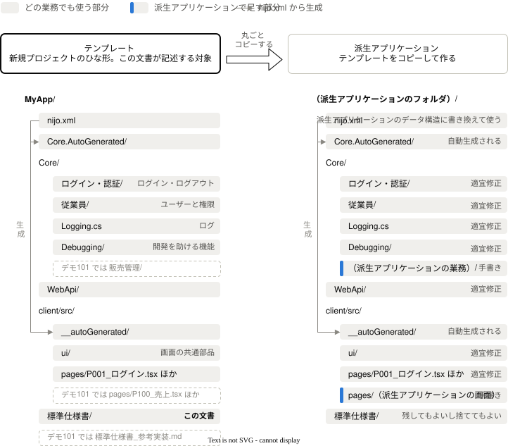

# 1. 概要

この文書の読み方と、2章以降を読むための前提となるアプリケーションの全体像をまとめる。

## 1.1 この文書について

nijo は、アプリケーションのデータ構造と処理を XML ファイル（nijo.xml）に定義し、そこから C# と TypeScript のコードを自動生成するツールである。生成されたコードの上に手書きのコードを追加して、業務アプリケーションを作る。

デモ101は、nijo で作った販売管理システムのデモである。デモ101から販売管理に固有の部分を取り除いたものを、新規プロジェクトのひな形（以下、テンプレート）として配布している。新しいアプリケーション（以下、案件）は、テンプレートを丸ごとコピーして作り始める。

- 案件は、テンプレートの任意の部分を必要に応じて修正し、業務独自の処理や画面を追加して、実稼働用のアプリケーションとして完成させていく。
- テンプレートの振る舞いは基本的にすべて変えられる。ただし、nijo が生成するコードで決まっていて変えられないものが一部ある。
- 案件は、コピーした後にテンプレートに入った修正を取り込む義務はない。問題がある場合は案件の責任で改修する。

この文書は、コピー時点のテンプレートに何が入っていて、どこまで対応しているかを説明する。あわせて、変えたい場合にどこまで変えられるか、よくある変更ではどこを編集すればよいかを示す。

- 想定読者は、テンプレートの採用を検討する人、開発者、運用担当者である。どの読者も、自分の立場だけでなく、完成したアプリケーションのほかの関係者の立場からも問題がないかを確かめるために読む。
- 業務のデータ構造・画面・処理は扱わない。それらは案件ごとに定める。
- 開発を始めるための準備と手順は、プロジェクトの README に書く。
- デモ101に固有の処理は、別ファイル `標準仕様書_参考実装.md`（このフォルダの外）にまとめている。こちらはテンプレートのコピー後には残らない。
- この文書もテンプレートと一緒にコピーされる。コピーした後は、案件の文書として保守してもよいし、捨ててもよい。

### 各章の構成

2章以降は、章ごとに1つの機能領域を扱う。章は、読者がアプリケーションを理解するうえで、ひとまとまりの責務として把握すべき単位で立てる。内容が少ない章も残す。その領域がそこまでしか整備されていないこと自体が、読者にとって情報だからである。

各章は、次の節からなる。書くことがない節は省く。

| 節 | 内容 |
|---|---|
| 概要（章の冒頭） | 続く節を読者全員が理解し、批判・検討できるようにするための説明。読者の間に共通の理解をつくるのが役目である。1章の内容は前提にしてよい |
| 外部仕様 | 完成したアプリケーションの外から見える振る舞い。仕様項目の表で書く。テンプレートが何を約束し、何を案件に委ねるかの責任分界になる |
| 限界 | 外部仕様の振る舞いでは足りなくなる条件と、そのときに取れる手段。外部仕様そのものは書かない |
| 主なカスタマイズ方法 | テンプレートのままではなく改変して使う可能性が高い部分の、変更の手順と注意点 |
| 開発者向け情報 | テンプレートの作りと、それに沿って作るときの決まり。ソースコードやそのコメントに書くべきことは書かない |

限界・主なカスタマイズ方法・開発者向け情報は、概要と外部仕様で拾いきれない情報を漏れなく拾うための節である。

分量の多い章は、読者の関心事ごとに話題を分け、話題ごとに上の節を置く。その場合も、章の冒頭に章全体の概要を書く。

外部仕様かどうかは、誰に向けたものかではなく、アプリケーションの外から見えるかどうかで分ける。画面、API の応答、ログ、メールなど、ソースコードを読まなくても動かせば分かる振る舞いは外部仕様である。運用担当者が開発者を兼ねていても、ログの内容は外部仕様である。プロジェクトの分け方やトランザクションの扱いのように、ソースコードの中だけで完結することは、開発者向け情報である。

図は、文や表を理解しやすくするための補助であり、仕様は書かない。矢印の意味などの解釈が、読み手によって揺れるためである。図に仕様が入らざるを得ない場合は、同じことを文や表にも書き、文や表を正とする。

### 仕様項目の表

外部仕様は、次の列をもつ表で書く。

| 列 | 内容 |
|---|---|
| ID | 仕様の識別子。接頭辞は仕様の表ごとに決める。1つの章に表が複数あるときは、表ごとに接頭辞が異なる。ID は振り直さない。仕様をやめたときは、その ID を欠番にする。章を組み替えて別の表に移った仕様も、元の ID のままにする |
| 仕様 | テンプレートの振る舞いを動詞で書く。nijo が生成するコードで決まっていて変えられない仕様には【自動生成コード由来のため変更不可】と書く |
| 確認方法 | 振る舞いを確認する方法。テスト（自動テストがある）、実演（動かして見る）、検査（ソースや定義を読む）のいずれか |
| 関連非機能要件 | その仕様が関わる非機能要件。値は IPA の非機能要求グレードの大項目（可用性、性能・拡張性、運用・保守性、移行性、セキュリティ、システム環境・エコロジー）から選ぶ。関わるものがない仕様は空にする |
| 備考 | 根拠、関係する仕様 |

ある非機能要件に関わる仕様を一覧したいときは、この列の値で検索する。

## 1.2 アプリケーションの全体像

テンプレートで作るアプリケーションは、利用者が Web ブラウザから使う業務システムである。次の部分からなる。

| 部分 | 説明 |
|---|---|
| クライアント | ブラウザで動く部分。利用者から見える画面と、サーバーを呼び出す処理からなる |
| サーバー | API の受け口、業務処理、DB へのアクセスからなる |
| DB | 業務のデータと、アプリケーションが動くために使うデータ（セッションなど）を保存する |
| ジョブ | 画面の操作とは切り離して、サーバーで後から実行する処理。定期実行する処理や、時間のかかる処理に使う |
| 外部システム | 連携する、開発チームの管理下にないシステム。環境によってはモック（本物の代わりに動く偽物）に差し替える |

アプリケーションのデータ構造と処理は nijo.xml に定義する。そこから、DB のテーブル、検索・登録・更新・削除の処理、画面から呼ぶ API などの定型的な部分が自動生成される。業務に固有の判断や画面は、生成された部分の上に手書きで作る。

nijo.xml に定義するものの中心は、役割の違う次の3つである。

| 名前 | 説明 |
|---|---|
| データモデル | DB に保存するデータ。テーブルと、登録・更新・削除の処理が生成される |
| クエリモデル | 画面で検索・表示するデータ。検索条件・検索結果の型と、検索の処理が生成される |
| コマンド | 更新などの処理。画面から呼ぶ API と処理の枠が生成され、処理の中身は手書きする |

- データ構造は、ほかのデータ構造を参照できる（Ref）。RDBMS の外部キーに近い。画面では、参照先のデータを検索ダイアログで探して選ぶ形になる。
- nijo.xml の項目や処理には、アプリケーション独自の属性（カスタム属性）を付けられる。表示の書式、入力チェック、ログでのマスキング、呼び出せる利用者の指定などに使う。カスタム属性は案件で追加できる。

アプリケーションを動かす環境は、開発環境と本番環境の2つに分ける。ASP.NET Core の環境の名前が Development のときを開発環境、それ以外を本番環境と呼ぶ。検証用やテスト用の環境も、Development でなければ本番環境として動く。ビルドの種類（Debug・Release）とは別の区別である。

## 1.3 関係者

この文書で「利用者」と書くときは、画面からアプリケーションを使う人（一般の利用者とシステム管理者）を指す。開発者と運用担当者は利用者と区別する。

| 関係者 | 説明 |
|---|---|
| 一般の利用者 | 業務画面を使う。権限に応じて使える機能が変わる |
| システム管理者 | 利用者のうち、ユーザーアカウントの保守、パスワードの再発行など、管理の機能を使える人 |
| 開発者 | アプリケーションを作り、保守する。開発環境で開発支援機能を使う |
| 運用担当者 | 本番環境を運用し、エラーの通知を受け取る |

## 1.4 使っている技術

主な技術とメジャーバージョンだけを書く。詳細なバージョンは各プロジェクトの定義を正とする。

| 分類 | 技術 | 変更可能 |
|---|---|---|
| サーバー | .NET 10、ASP.NET Core | 不可 ※ |
| DB アクセス | Entity Framework Core 10 | 不可 ※ |
| DB | SQLite（本番では別の製品に差し替えることが多い） | 可 |
| ログ | NLog 6 | 可 |
| API の一覧の表示 | Swagger（開発環境だけ） | 可 |
| 画面 | React 19、TypeScript 5、React Router 7、React Hook Form 7、Tailwind CSS 4、Vite 7 | 可 |
| テスト | NUnit 4（サーバー）、Vitest 3（画面） | 可 |
| 手順のスクリプト | bash（リリース用のビルドだけは Windows のバッチファイル） | 可 |

※ バージョンアップは可能

- ソースの識別子（データ構造名、項目名、処理名、一部のファイル名）には日本語を使っている。
- ライセンスは [LICENSE.txt](../LICENSE.txt) を参照。

## 1.5 テンプレートに含まれないもの

次のものはテンプレートに含まれない。必要な場合は案件で作る。各章の「限界」もあわせて参照のこと。

- 認証関連
  - 外部の認証基盤（Windows認証、SSO、OpenID Connect、多要素認証）
  - パスワードポリシー（長さ・文字種・有効期限）
  - 初回ログイン時のパスワードの変更の強制
  - アカウントのロック
  - ユーザーの無効化・利用期間
  - ログインからの最大継続時間によるセッションの期限
- ロールやグループによる権限
- 操作ログ・監査ログ（ログイン履歴、データの変更前後の値）
- ファイル入出力（CSV・Excel の出力と取り込み）
- 帳票・印刷
- ワークフロー（申請・承認）
- 営業日・休業日のカレンダー
- メンテナンス中の表示（利用者の操作を止める仕組み）
- 画面から変える設定（システム全体の設定、ユーザーごとの画面の設定）
- 外部のシステムから呼ばれる API の認証（API キーなど）
- 画面での個人情報のマスキング、DB の中のデータの暗号化
- 画面を通した自動テスト（E2E テスト）
- 多言語対応（日本語だけを前提にしている）
- スマートフォン向けの画面
- 本番環境の構築・デプロイ・本番 DB へのマイグレーションの適用・監視・バックアップの手順
- CI

## 1.6 開発者向けの前提

この節は、各章の開発者向け情報を読むための前提である。開発者以外の読者は読まなくてよい。

- **再生成**：nijo.xml を変えた後、nijo のコマンドラインツールでコードを生成し直すこと。自動生成されたコードは再生成で上書きされるので、手で編集しない。
- **アプリケーションサービス**（ApplicationService）：業務ロジックを書くクラス。画面からの API も、ジョブも、単体テストも、このクラスを通して業務処理を呼ぶ。nijo が基底クラスを生成し、処理の中身は手書きのクラスに書く。
- **オペレーションコンテキスト**（OperationContext）：1回のオペレーション（画面からの呼び出し1回など）を通じて、呼び出し元と処理の間で情報を受け渡す入れ物。入力チェックだけを行うかの指定や、更新の前に利用者に了承を求めるメッセージ（確認メッセージ）のように、すべての処理に共通の入出力を受け渡す。
- **テンプレート文字列**（Templates）：nijo.xml に定義する文字列の雛形。利用者に見せるメッセージや、サーバーと画面の両方で使う URL の正本を置く。ひな形の意味の「テンプレート」とは別のものである。
