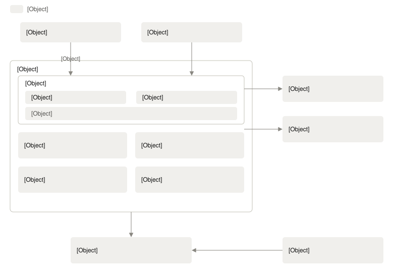
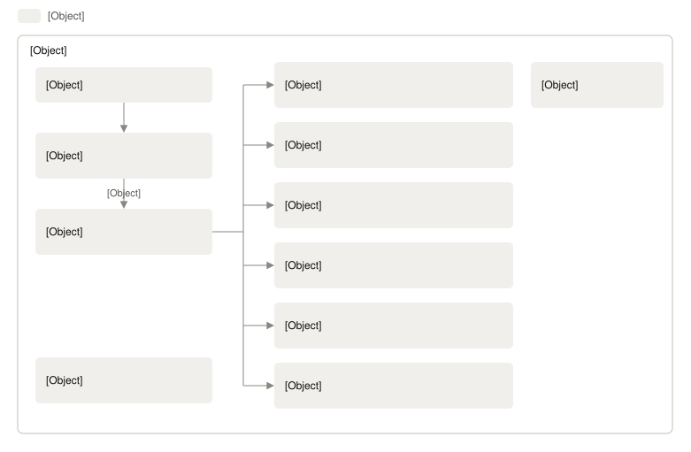

# 2. 実行環境

アプリケーションを動かすときの構成と、日時のタイムゾーンを扱う。画面を手で動かして確かめる人や、本番環境を運用する人が知っておくべきもの（設定ファイル、ログファイル、モックのファイルなど）も、次の図に載せる。

アプリケーションを動かす環境は、開発環境と本番環境の2つに分ける（ENV-008）。

### 本番環境

- 設定ファイル：DPL-003、16章。
- マイグレーションの SQL：MIG-001、17章。
- エラーの通知のメールは、テンプレートのままでは送られない（ALR-006）。
- 外部システムを本物にするかモックにするかは、外部システムごとに設定で決める（EXT-002）。

### 開発環境

- 開発環境用の設定ファイルと SQLite のファイルは、開発者ごとに持つ。
- 外部システムのモックがファイルを読み書きする場合、テストする人はその中身を確かめたり書き換えたりする。ファイルの有無と場所は、外部システムごとのモックで決まる。

## 2.1 外部仕様

| ID | 仕様 | 確認方法 | 関連非機能要件 | 備考 |
|---|---|---|---|---|
| ENV-001 | 利用者は Web ブラウザから利用する。対応するブラウザは定めておらず、ブラウザごとの動作確認も行っていない | 実演 | | 使っている技術（Tailwind CSS 4）が前提にするのは、Chrome・Edge 111 以降、Firefox 128 以降、Safari 18.4 以降である |
| ENV-002 | 本番環境では、サーバーの1つのプロセスが画面と API の両方を配信し、画面と API は同じオリジンになる | 検査 | | 開発環境では、画面は画面の開発サーバーが配信し、API の呼び出しは画面の開発サーバーがサーバーに中継する |
| ENV-005 | サーバーは、テンプレートの設定のままでは HTTP で待ち受け、HTTPS（TLS）を終端しない。本番環境では HTTPS でアクセスしないとログインできないので（SES-003）、リバースプロキシやロードバランサーで HTTPS を終端するか、サーバーに証明書を設定して HTTPS で待ち受けるかを、案件で決める | 検査 | セキュリティ | 待ち受けのポートや証明書は、ASP.NET Core の標準の設定（環境変数など）で指定する（CFG-003 の対象外）。リバースプロキシやロードバランサーで終端するときの注意は SEC-001 と 2.2 |
| ENV-006 | サーバーのプロセスをどう動かすか（IIS の上、コンテナ、コマンドとして起動するなど）は定めていない。Windows のサービスとして動かす組み込みはしていない | 検査 | 運用・保守性 | 動かし方によっては、標準エラー出力にだけ出る起動の失敗の理由（LOG-008）を受け取れない（18章の限界） |
| ENV-008 | 開発環境か本番環境かは、ASP.NET Core の環境の名前（環境変数 `ASPNETCORE_ENVIRONMENT` など）で決まる。`Development` なら開発環境、それ以外と未設定は本番環境である。検証用やテスト用の環境も、`Development` でなければ本番環境として動く。ビルドの種類（Debug・Release）とは別の区別である | 検査 | セキュリティ、運用・保守性 | 本番環境を誤って `Development` で動かすと、本番環境だけの振る舞い（SES-003、SEC-007、MIG-001 など）が外れる |
| ENV-007 | アプリケーションは、ホストの直下（`https://example.com/`）に置くことを前提にしている。画面の URL と API の URL は、どちらも `/` から始まる | 検査 | | |
| ENV-003 | テンプレートで使う DB は SQLite である | 検査 | | 本番で別の DB の製品を使う方法は 17.3 |
| ENV-004 | 日時は、設定で決めた1つのタイムゾーン（業務のタイムゾーン。テンプレートの設定ファイルの初期値は日本時間 Asia/Tokyo）の現地時刻として扱う。サーバーの現在時刻も、OS のタイムゾーンによらず、このタイムゾーンの時刻を使う。画面の中で現在時刻を使う処理（入力欄の初期値など）は、ブラウザのタイムゾーンの時刻になる | テスト | | 設定したタイムゾーンが見つからなければ、起動を止める。ログのファイル名の日付は例外で、OS のタイムゾーンによる（LOG-010）。ほかに日時に関わる仕様：LOG-002、JOB-006、TYP-014 |
| SEC-001 | HTTP で受けた要求を、HTTPS の URL にリダイレクトしない。応答に HSTS のヘッダー（`Strict-Transport-Security`）を付けない | 検査 | セキュリティ | SES-003 |
| SEC-002 | ほかのオリジンからの呼び出しを許可するヘッダー（CORS の `Access-Control-Allow-Origin` など）を返さない。そのため、ほかのオリジンのページのプログラム（JavaScript）は、API の応答を読めず、独自のヘッダーを付けた呼び出しも送れない | 検査 | セキュリティ | 画面と API が同じオリジンなので（ENV-002）、許可は要らない |

## 2.2 限界

- HTTPS の URL へのリダイレクトと HSTS が必要なら、リバースプロキシやロードバランサーで行うか、アプリのソースを変えて有効にする（2.3）。設定ファイルでは切り替えられない（SEC-001）。
- サブパス（`https://example.com/app/` など）に置くには、画面のルーティングとビルドの設定、API の URL の組み立てを改修する（ENV-007）。
- Windows のサービスとして動かすには、サーバーの起動処理を改修する（ENV-006）。
- 画面の中で業務のタイムゾーンの現在時刻が要るときは、サーバーから受け取る（ENV-004）。
- 業務のタイムゾーンは1つだけである（ENV-004）。利用者ごとのタイムゾーンや、UTC での保存には対応しない。
  - 日本国内だけで使われ、夏時間もない前提で割り切っている。UTC で保存して表示のたびに変える作りは、画面・SQL・日付の境目のすべてで変換が要り、誤りの元が多くなる。
  - 夏時間のあるタイムゾーンは想定していない。現在時刻は、経過時間を数える処理（ログインの失敗の回数の制限など）も含めて業務のタイムゾーンの現地時刻なので、夏時間の切り替えの前後では時刻が前後する。
  - 海外の利用者や拠点がある案件では、日時を UTC で保存し、画面で利用者のタイムゾーンに変える作りに改める。

## 2.3 主なカスタマイズ方法

### HTTPS の URL へのリダイレクトと HSTS をアプリで行う

- WebApi の起動処理に、ASP.NET Core のリダイレクト（`UseHttpsRedirection`）と HSTS（`UseHsts`）を、コメントにして置いている。リダイレクトは、死活の確認の後、応答を返すほかの処理より前に置く。死活の確認までリダイレクトすると、ロードバランサーが HTTP で死活を確かめる構成で失敗する。
- リダイレクト先のポートは、設定（`https_port`、環境変数 `ASPNETCORE_HTTPS_PORTS` など）か、アプリが HTTPS で待ち受けていることから決まる。どちらもなければリダイレクトせず、警告のログを出すだけになる。テンプレートの設定ファイルにはどちらもない。
- リバースプロキシやロードバランサーで HTTPS を終端する構成では、アプリには HTTP で届く。元の要求のプロトコルを受け取る設定（ASP.NET Core の Forwarded Headers）をしないと、HSTS のヘッダーは付かず、リダイレクト先のポートを設定していればリダイレクトが繰り返される。

## 2.4 開発者向け情報

- 業務処理で現在時刻が必要なときは、 `DateTime.Now` ではなくアプリケーションサービスから取得する。1回のリクエストの中では同じ時刻が返る。テストで時刻を固定できるようにするため、また処理中で午前0時を跨いでロジックの途中で日付が変わるのを防ぐため。
- SQL の中でも、DB の現在時刻（`CURRENT_TIMESTAMP` など）は使わず、アプリケーションから現在時刻を渡す。DB サーバーのタイムゾーンで記録されるのを防ぐため（ENV-004）。
- nijo の日付時刻型は、C# ではタイムゾーンのオフセットをもたない `DateTime` として生成される。日時を UTC で保存する作りに改めても、値が UTC であることは型では表せないので、決まりとして守る必要がある。
