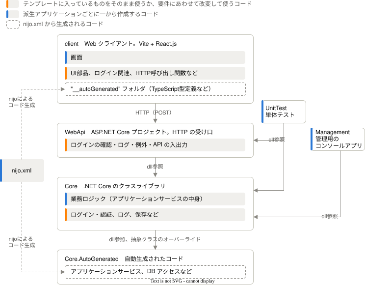

# 3. プロジェクトの構成と業務処理の書き方

プロジェクトの分け方、自動生成されたコードと手書きのコードの境界、業務処理を書く場所を扱う。

## 3.1 主なカスタマイズ方法

### アプリケーションの名前と名前空間を変える場合

- テンプレートの名前 `MyApp` でフォルダ全体を検索し、新しいアプリケーションの名前に置き換える。
- 置き換える対象の種類は次のとおり。個々のファイルの一覧は検索の結果を正とする。
  - nijo.xml のアプリケーション名とルート名前空間（変えたら再生成する）
  - 手書きのコードの名前空間
  - ソリューションとプロジェクトのファイル名、プロジェクト間の参照
  - client プロジェクトのパッケージ名
  - 画面に表示するアプリケーション名とブラウザのタブのタイトル
- 置き換えた後、再生成・ビルド・型チェックが通ることを確認する。

### nijo のバージョンを上げる場合

- 新しいバージョンの nijo で再生成し、差分で変更点を確かめ、ビルドと単体テストでエラーがないことを確認する。生成される基底クラスが変わり、手書きのクラスの修正が要ることがある。

### nijo を使うのをやめる場合

- nijo.xml と、再生成を行う手順のスクリプトの処理を削除する。以降は、生成されたコードを手書きのコードと同じように保守する。アプリケーションの動作は変わらない。

## 3.2 開発者向け情報

### 自動生成されたコードと手書きのコード

- nijo は、アプリケーションサービスや DB へのアクセスのクラスなどの基底クラスを生成する。nijo.xml に定義した処理は、基底クラスのメソッドの枠として生成されるので、その中身を、基底クラスを継承した手書きのクラスに書く。
- 自動生成されたコード（Core.AutoGenerated プロジェクトと、client プロジェクトの中の自動生成されたフォルダ）は、バージョン管理の対象にする。そのため、ビルドやリリースに nijo は要らない。再生成で上書きされるので、手で編集しない。
- nijo.xml を変えたら、再生成した結果を同じコミットに含める。nijo.xml と生成されたコードが食い違ったままコミットされるのを防ぐ仕組みはないので、この決まりで防ぐ。
- 自動生成されたコードは通常の C# と TypeScript のコードで、実行時に nijo のライブラリを必要としない。依存するのは Entity Framework Core などの一般的なライブラリだけである。
- 生成されたコードの先頭のコメントに、生成した nijo のバージョンが書かれる。コミットの識別子は含めないので、同じバージョンの nijo で生成し直しても差分は出ない。開発者の間で nijo のバージョンをそろえる仕組みはないが、違うバージョンで再生成すると差分が出るので、コミットの前に気付ける。

### 業務処理の書き方

- 業務ロジックは、Core のアプリケーションサービス（1.6）に書く。同じ業務ロジックを、画面・ジョブ・単体テストのどこからでも使えるようにするためである。
- アプリケーションサービスは1つのクラスで、複数のファイルに分けて書ける形にしてある。業務の処理は、次のようにファイルを分けて書く。
  - Core プロジェクトの中に、業務のまとまりごとのフォルダを作る。コマンド・クエリモデル1つにつき1ファイルとし、ファイル名はその名前にする。
  - 複数のコマンドで共有する、データモデルの整合性のチェックや保存の後の処理は、そのデータモデル用のファイル（`{データモデル名}DataModel.cs`）にまとめる（11.4）。
  - 外部システムとの通信は、外部システムごとのフォルダに、インターフェースと本物の実装とモックを置く（12.4）。コマンドやクエリモデルのファイルには直接書かない。
- 業務のフォルダや画面のファイルを丸ごと削除しても、残りがビルドできるように作る。業務単位で機能を取り外せるようにするためである。ただし、マスタのように他の業務から使われる業務は対象外とする。
- 業務処理で現在時刻が必要なときは、 `DateTime.Now` ではなくアプリケーションサービスから取得する。1回のリクエストの中では同じ時刻が返る。テストで時刻を固定できるようにするため、また処理中で午前0時を跨いでロジックの途中で日付が変わるのを防ぐため。
- SQL の中でも、DB の現在時刻（`CURRENT_TIMESTAMP` など）は使わず、アプリケーションから現在時刻を渡す。DB サーバーのタイムゾーンで記録されるのを防ぐため（ENV-004）。
