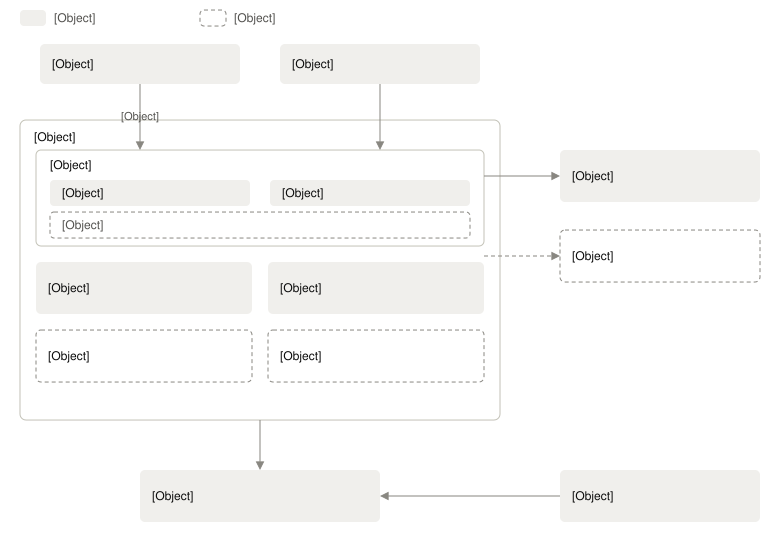
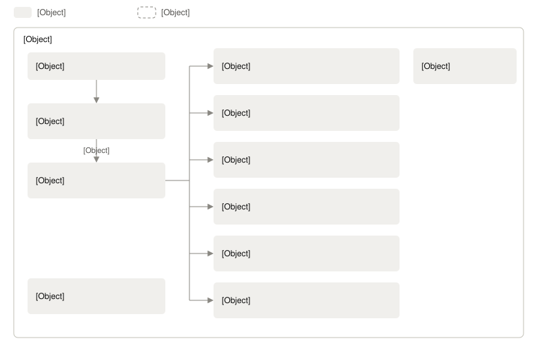

# 3. 実行環境

アプリケーションを動かすときの構成と、日時のタイムゾーンを扱う。画面を手で動かして確かめる人や、本番環境を運用する人が知っておくべきもの（設定ファイル、ログファイル、モックのファイルなど）も、次の図に載せる。

### 本番環境

- 設定ファイルはリリース用のモジュールに含まれず、リリース先に置いたものを使う（DPL-003）。設定の内容は5章。
- マイグレーションの SQL は、リリースの手順に含まれない。リリースのたびに手で流す（24.6）。
- 外部システムを本物にするかモックにするかは、外部システムごとに設定で決める（EXT-002）。

### 開発環境

- 開発環境用の設定ファイルと SQLite のファイルは、開発者ごとに持つ。
- 外部システムのモックがファイルを読み書きする場合、テストする人はその中身を確かめたり書き換えたりする。ファイルの有無と場所は、外部システムごとのモックで決まる。

## 3.1 外部仕様

| ID | 仕様 | 確認方法 | 関連非機能要件 | 備考 |
|---|---|---|---|---|
| ENV-001 | 利用者は Web ブラウザから利用する。対応するブラウザは定めておらず、ブラウザごとの動作確認も行っていない | 実演 | | 使っている技術（Tailwind CSS 4）が前提にするのは、Chrome・Edge 111 以降、Firefox 128 以降、Safari 18.4 以降である |
| ENV-002 | 本番環境では、WebApi の1つのプロセスが画面と API の両方を配信し、画面と API は同じオリジンになる | 検査 | | 開発環境では、画面は画面の開発サーバーが配信し、API の呼び出しは画面の開発サーバーが WebApi に中継する |
| ENV-003 | テンプレートで使うDBは SQLite | 検査 | | 本番で別の DB の製品を使う方法は 6.2 |
| ENV-004 | 日時は、設定で決めた1つのタイムゾーン（業務のタイムゾーン。既定では日本時間 Asia/Tokyo）の現地時刻として扱う。現在時刻も、サーバーの OS のタイムゾーンによらず、このタイムゾーンの時刻を使う | テスト | | 設定したタイムゾーンが見つからなければ、起動を止める |

## 3.2 限界

- 画面の中で現在時刻を使う処理（入力欄の初期値など）は、ブラウザのタイムゾーンの時刻になる。業務のタイムゾーンの時刻が要るときは、サーバーから受け取る。
- 業務のタイムゾーンは1つだけである（ENV-004）。利用者ごとのタイムゾーンや、UTC での保存には対応しない。
  - このように割り切っているのは、テンプレートで作るアプリケーションの多くが日本国内だけで使われるためである。日本には夏時間がないので、現地時刻のまま扱っても、同じ時刻が2回現れたり、存在しない時刻が生じたりしない。UTC で保存して表示のたびに変える作りにすると、画面・SQL・日付の境目（「今日」の範囲など）のすべてで変換が要り、得られる利点に比べて誤りの元が多くなる。
  - 海外の利用者や拠点がある案件では、日時を UTC で保存し、画面で利用者のタイムゾーンに変える作りに改める。nijo の日付時刻型は、C# ではタイムゾーンのオフセットをもたない `DateTime` として生成されるので、値が UTC であることは型では表せない。決まりとして守る必要がある。
