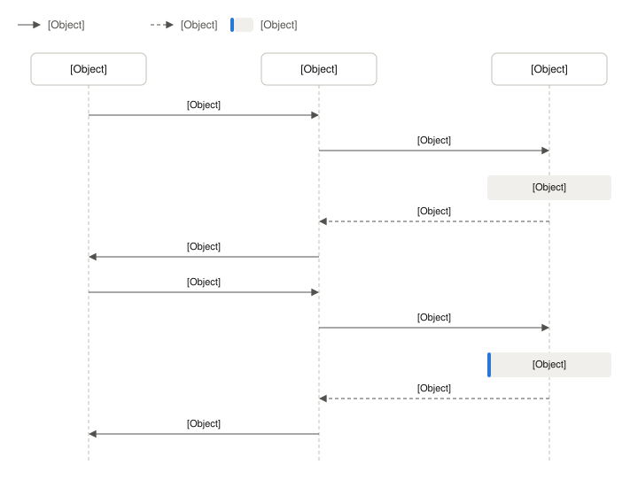

# 11. 更新

データの登録・更新・削除と、その前の確認メッセージ、入力チェック、楽観排他、トランザクションを扱う。

次は、データを編集する画面で保存ボタンを押したときの流れである。

- 1回目の呼び出しでエラーがあれば、項目の近くに表示して終わる（API-002）。
- 利用者が了承しなければ、何もせずに終わる。
- 検索は確認を挟まず、1回だけ呼び出す。

## 11.1 外部仕様

| ID | 仕様 | 確認方法 | 関連非機能要件 | 備考 |
|---|---|---|---|---|
| UPD-001 | データモデルのすべてのテーブルに、作成者・作成日時・更新者・更新日時の列がある 【自動生成コード由来のため変更不可】 | 検査 | | |
| UPD-002 | 作成者・更新者には、その操作をしたログインユーザーを記録する。ログインユーザーがいない処理では、その処理の名前を記録する | テスト | | ユーザーは ID の文字列で記録し、ユーザーへの外部参照にはしないので、ユーザーを削除しても記録は残る。画面から起動したジョブでは起動したユーザーを、定期実行のジョブではジョブの種類を記録する（18.4） |
| UPD-003 | データ構造ごとに論理削除か物理削除かを選べる。論理削除は削除フラグ方式ではなく、削除前テーブルとほぼ同じ構造の削除済みテーブルに移送する方式を採用する。 | 検査 | | 論理削除を使うかは nijo.xml で指定する。削除フラグ方式については 11.3 を参照。 |
| UPD-004 | 同じデータを複数の人が同時に更新したときは楽観排他制御を用いた先勝ち、つまり後から保存した人にエラーを返す形とする。 【自動生成コード由来のため変更不可】 | テスト | | 排他の範囲はDBのテーブル単位ではなく nijo.xml のデータモデルの範囲。排他発生時の画面表示のルールは UPD-007 を参照。 |
| UPD-005 | 画面から行なう複数のデータの一括更新は、原則として1件でも失敗したら全件ロールバックする。 | 検査 | | 例外的に個別コミットする処理がある場合は個別に取り決める。 |
| UPD-006 | 保存などの更新の操作では、原則として、まず入力チェックだけを行い、エラーがなければ確認のメッセージを表示し、利用者が了承してから実際に更新する。サーバーの呼び出しは2回になる | 実演 | | 確認の文言はサーバーの処理が指定し、指定がなければ既定の文言を出す。取り消しが容易な操作など、確認を挟まない操作は個別に決める |
| UPD-007 | 楽観排他（UPD-004）のエラーになったときは、他の人が先に更新したことを伝えるメッセージを表示する。入力中の内容はそのまま残し、自動では読み込み直さない | 実演 | | 入力中の内容を控えてから読み込み直せるようにするため。最新の内容は、利用者がブラウザで画面を読み込み直して確かめる。編集中の内容があるので、読み込み直す前に確認が出る（UI-007）。メッセージは画面を経由しない処理（バッチなど）でも使うので、画面の操作の案内は含めない |
| UPD-008 | 更新を伴う処理の呼び出しには、利用者の操作1回ごとに作る冪等キーを付ける。サーバーは、同じキーで2回目以降に呼ばれた処理を実行せず、実行済みであることを返す | テスト | | 呼び出しを打ち切った後（API-006）の操作のし直しや、ボタンの二重押しで、二重に登録されるのを防ぐため。画面の保存などでは、成功するまで同じ冪等キーを使い続ける |
| UPD-009 | クリーンナップは、記録してから24時間が経った冪等キーを削除する | 検査 | | 打ち切られた操作を利用者がやり直すまでの間は残しておく必要がある |

## 11.2 限界

- 1回の呼び出しの中でトランザクションを複数回開始する処理（1件ずつ確定するものなど）では、冪等キー（UPD-008）は最初にコミットしたトランザクションで記録する。途中で失敗した後に同じ冪等キーで送り直すと、処理済みとして扱われ、残りは処理されない。
- 冪等キーを付けない呼び出し元（単体テスト、バッチ）からの呼び出しは、UPD-008 の対象外である。
- 同じ冪等キーの呼び出しが並行したとき、後の呼び出しは、先の呼び出しのトランザクションが終わるまで DB の書き込みのロックで待たされる。先の処理が DB のコマンドの待ち時間（既定は30秒）より長引くと、後の呼び出しは処理済みであることを返せず、予期しない例外（API-004）になる。
- 複数件の保存（UPD-005）は、件数が多いと1回の処理が重くなる。件数と処理時間の関係は未計測。足りないときは、11.3 の「一括更新のコミット粒度を変える」による。

## 11.3 主なカスタマイズ方法

### 削除フラグによる論理削除を行う

特別な仕組みは用意していないので、単に各データに削除フラグを逐一定義したり、EFCoreのグローバルクエリフィルターで削除フラグtrueのデータを弾いたりすることで対応する。削除フラグ方式を標準としていない理由は以下。

- 簡単に削除フラグが使える基盤を用意してしまうと、人の退職済みやワークフローの取り下げといった本来削除フラグではなく独立したステータスとして管理すべき状態に削除フラグが濫用されてしまう可能性が上がるので、これを防ぐため。
- 通常のスクラッチ開発では削除前テーブルと削除済みテーブルで構造を一致させ続けるのが難しく、ここが削除フラグ方式を採用する主な動機になるが、nijoによるソースコードの自動生成が使える前提だとこの一致コストが低いため。
- 削除フラグより別テーブル移送方式の方がRDBMSの外部キー制約によるデータの整合性の恩恵をより受けることができるため。

### 一括更新のコミット粒度を変える

- UPD-005 は手書きのコードで決めているので、分割してコミットする、一括更新の SQL を使うなど、自由に変えてよい。
- 変えた場合は、UPD-004 と、11.4 の「保存の処理」に書いた振る舞いが保たれるかを確認する。

### データの変更前後の値を残す

- テンプレートには変更前後の値の記録はない（1.5）。
- データモデルの保存は、手書きの保存の共通の処理を必ず経由する。そこで Entity Framework Core の変更追跡の情報から、変更前後の値を取り出して記録する。nijo の側の対応は必要ない。
- 記録先（専用のテーブル、ログ）と、記録する項目は案件で決める。テーブルに記録する場合は、業務データと同じトランザクションで保存する。
- マスキング（LOG-004）に指定された項目を記録しないよう注意する。

## 11.4 開発者向け情報

### 更新の処理の流れ

コマンドの処理は、典型的には次の順に書く。当てはまらない段は省く。
権限の確認は、処理の本体の前に共通の処理で行われるので（AUZ-001）、処理の中には書かない。

1. 更新するデータの読み込み、または新しいデータの作成
2. 値の設定と入力チェック。エラーがあればここで終える
3. 入力チェックだけを行う指定（11.4 の「確認メッセージ」）であれば、確認メッセージを積んで終える
4. トランザクションの開始
5. 保存。失敗したらコミットせずに終える
6. コミット。予約した外部システムの更新も、ここで実行される（12.4）
7. 完了のメッセージと戻り値を返す。戻り値はコミットの後に確定する。コミットの前に確定すると、失敗したときに存在しないデータを画面に返してしまうため

### 保存の処理

- データモデルの登録・更新・削除は、生成された入力チェックを通した検証済みのデータを保存の処理に渡して行う。DB に直接書き込まない。作成者・更新者などの記録と楽観排他が、保存の処理の中で行われるため。意図して迂回するときは、理由をコメントに残す。
- 手書きの入力チェックのエラーは、検証済みのデータができるかどうかには影響しない。保存の前に、エラーがないかを確かめてから保存する。
- 入力チェックのエラーと保存の結果のエラーは、画面のメッセージのオブジェクトの、対応する位置に移す。移し忘れると、保存されないのに利用者には何も表示されない。
- どの処理から保存しても守るべきデータのルール（明細は1件以上、確定した明細は変えられない、など）と、保存の後に必ず行う処理は、データモデル用のファイルに名前付きのメソッドとして書き、そのデータモデルを保存するすべてのコマンドから呼ぶ。自動では呼ばれないので、コマンドを追加するときは呼び漏らさないよう既存のコマンドを確かめる。
- 入力チェックは以下の3段階で行う。カスタム属性による入力チェックの中身は手書きする。型ごとのチェックの中身は 6.1 の TYP の仕様。
  - nijo.xml の定義（必須、桁数など）に基づいて自動生成されたもの
  - カスタム属性によるもの
  - 手書きのもの（コマンドモデルの中に書く）
- データモデルの集約ルートのテーブルには、楽観排他（UPD-004）のためのバージョンの列が生成される。子孫テーブルには生成されない。
- 楽観排他で照合するバージョンには、画面からの更新では画面がデータを読み込んだ時点のものを、画面を経由しない更新（パスワード再発行など）では処理の中でデータを読み込んだ時点のものを使う。保存の直前に DB から読み直したバージョンを使うと、利用者が画面を開いている間のほかの人の更新を、黙って上書きしてしまう。バージョンがないと例外になり、楽観排他は省略できない。
- 保存されるのは、入力チェックを通った時点の値である。チェックの後で値を書き換えても保存されない。
- 保存の処理（`TrySaveAsync`）は、nijo が生成するものではなく、テンプレートの手書きのコードである。保存のときに行うべきことは案件の要件で大きく変わるので、書き換えてよい。使い方の細部（渡せるデータの組み合わせ、保存後のデータの引き当て方など）は、ソースのコメントを正とする。
- 保存の処理は、次の順に行う。
  1. トランザクションが開始されていなければ、例外にする。保存の処理は、トランザクションの開始・確定・取り消しを行わない。
  2. 保存の前にほかの変更が追跡されていれば、例外にする。それが巻き添えで保存されるのを防ぐため。
  3. 同時に保存するデータどうしでキーが重複していれば、一意制約違反として失敗にする。
  4. 作成者・作成日時・更新者・更新日時と楽観排他のバージョンを設定し、まとめて DB に書き込む。
  5. 成否によらず変更の追跡を終える。成功したら、保存したデータを Info でログに出し、保存後のデータを返す。
- DB に書き込むときの失敗は、例外ではなく戻り値で返す。失敗の種類とログのレベルは下の表のとおり。これら以外の例外は、そのまま投げる。失敗してもトランザクションは使い続けられるので、確定するかは呼び出し側が決める。
- Entity Framework Core が DB のエラーを Error で出すログは、Warning に下げている。一意制約違反などで運用担当者に通知（ERR-001）が届かないようにするため。その他の DB のエラーは、保存の処理が Error で出す。
- 失敗のメッセージは、項目ごとではなく保存処理全体の単位で返る。どの行で起きたかを捕まえるのが難しいため。キーの重複を行ごとに見せたい場合は、入力チェックの段階で独自に確かめる。入力チェックのエラーは項目ごとに返り、画面では項目の近くに表示される（API-002）。
- 1回の保存に渡した検証済みのデータは、成否によらず、もう一度渡すことはできない。

| 失敗の種類 | 原因 | ログのレベル |
|---|---|---|
| 楽観排他 | ほかの人が先に更新した（UPD-004） | Warning |
| 一意制約違反 | 同じキーのデータがすでにある。ほかの人との操作の競合であることが多い | Warning |
| その他の DB のエラー | 上記以外の、DB に書き込むときのエラー | Error |

- DB から読んだデータは、既定では変更を追跡しない。必要な処理でだけ追跡を有効にする。

### 確認メッセージ

確認メッセージ（UPD-006）は、オペレーションコンテキスト（8.3）を使って、次のように扱う。

- 1回目のリクエストは、入力チェックだけを行う指定で実行する。エラーがなければ、確認メッセージと、確認が必要であることを返す。
- 2回目のリクエストには、確認済みであることを表す指定を付ける。サーバーは、確認済みのリクエストを、入力チェックだけではない実行として処理する。確認を挟まない呼び出し（ログイン、初期表示など）は、1回目から確認済みとして送る。
- 処理の中では、入力チェックの後、入力チェックだけを行う指定であれば、確認メッセージを積んで、トランザクションを始める前に終える。自動生成された部品と保存の処理はこの指定を見ないので、処理の中で判定する。生成された入力チェックまでは、この指定のときも実行し、データモデルのエラーも1回目で利用者に見せる。
- 入力チェックだけを行う指定のときは、DB・外部システム・ファイル・メールなど、あらゆる書き込みを行わない。
- 確認を扱えない呼び出し元（ジョブ、バッチなど）から呼んだ処理では、確認メッセージは無視され、処理が続く。確認メッセージを利用者に見せるか無視するかは、処理ではなく呼び出し元が決める。

### トランザクション

- トランザクションは、アプリケーションサービスがもつトランザクション開始のメソッド（`BeginTransactionAsync`）で始める。DbContext から直接始めると、外部システムの更新（12.4）がトランザクションに連動しなくなる。
- トランザクションは、明示的にコミットしたときだけ確定する。コミットせずに終わると、すべて取り消される。取り消しを明示的に書く必要はない。
- トランザクションの範囲は業務の要件から決め、コマンドの処理の中で見えるように書く。全件をまとめて確定するならループの外で1回、1件ずつ確定するならループの中で開始とコミットを繰り返す。1件ずつ確定する場合は、その理由をコメントに残し、一部だけが成功したことを利用者に伝えるメッセージも作る（UPD-005）。
- トランザクションは入れ子にできない。入れ子にしようとすると例外になる。

### 冪等キー

- 冪等キーは、クライアントの呼び出しの共通の関数が作り、`Idempotency-Key` ヘッダーで送る。確認メッセージの1回目と2回目、ログインし直した後の送り直しでは、同じキーを使う。
- 利用者の操作で更新を行う画面（保存ボタンなど）では、成功するまで同じキーを使い続ける関数を使う。成功したら、次の操作のために新しいキーに替える。更新を行う画面を追加するときは、こちらを使う。
- サーバーは、トランザクションを開始したときに、キーを専用のテーブル（nijo.xml の「冪等キー」）に、業務のデータと同じトランザクションの中で記録する。コマンドの処理の中で冪等キーを扱う必要はない。
- 同じキーがすでに記録されていれば一意制約にかかり、トランザクションの開始で処理が中断される。業務の処理が失敗して取り消された場合はキーの記録も取り消されるので、送り直せば処理される。
- 入力チェックだけを行う呼び出しは、トランザクションを開始しないので、キーを記録しない。
- 同じキーで並行して呼ばれた場合は、先にキーを記録した側のトランザクションが終わるまで、DB の書き込みのロックで待たされる。

