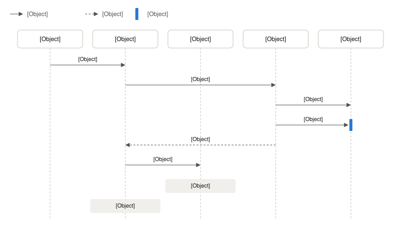
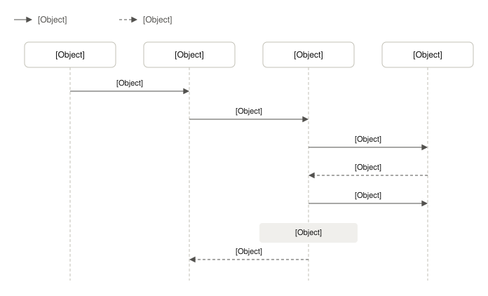
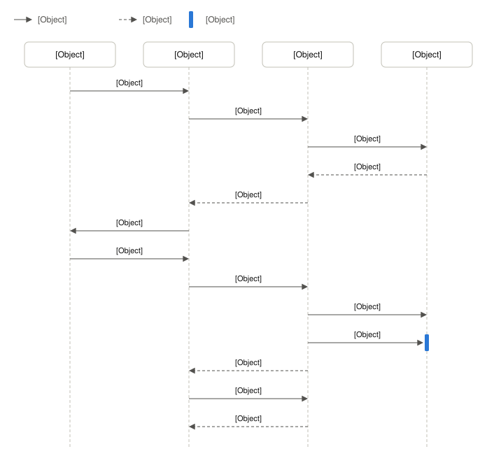
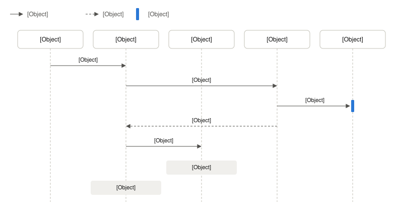
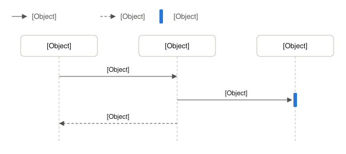

# 14. 認証

ログイン、セッション、パスワードと、ユーザーアカウントの保守を扱う。

テンプレートではパスワードによるログインのみを用意している。ログイン画面やユーザーアカウントの保守の画面も含め、案件に合わせて作り直すことを想定している。

ユーザーを表すデータ構造「従業員」は、デモから引き継いだ名前だが、多くの箇所から参照されているので、置き換えると広い範囲に影響する（14.6）。

## 処理の流れ

青い印は、セッションを作る・消すなど、ログイン状態が変わる処理を表す。

### ログイン

利用者が、ログイン画面か、重ねて表示されたログインの入力欄でログインしたときの流れ。

- ユーザー ID かパスワードが誤っていれば、どちらが誤っているかを区別しないメッセージを表示して終わる（AUTH-003）。
- セッションキーは Cookie で返す（SES-001、SES-002）。
- ほかのタブへは、ブラウザの `localStorage` を通じて知らせる。ほかのタブは、編集中の内容があれば確認してから読み込み直す（AUTH-006）。

### 画面を開く・操作する

利用者が画面を開いたとき、または画面からサーバーの処理を呼んだときの流れ。

- 画面を開いたときは、処理「ログイン状態確認」でログインユーザーを問い合わせ、その画面を開いている間は結果を使い続ける。
- セッションキーの照合は、1回のリクエストで1回だけ行う。
- ログインしていなくても呼び出せる処理は、AUTH-009 に挙げたものに限る。

### ログイン状態が切れていたとき

ログアウトでセッションが消えた後や、最後の操作から一定時間が経った後に、利用者が操作したときの流れ。

- ログインの入力欄を重ねて表示している間も、画面と入力中の内容はそのまま残る（SES-005）。
- 別のユーザーでログインし直したときは、呼び出しを送り直さずに画面を読み込み直す（SES-005）。
- ログインし直さずに入力欄を閉じたときは、ログイン状態が切れていることを伝えるエラーを表示する。

### ログアウト

利用者がログアウトしたときの流れ。

- 編集中の内容があれば、ログアウトの前に確認する（AUTH-008）。
- ほかのタブへは、ログインと同じく `localStorage` を通じて知らせる。

### クリーンナップ

システム管理者が処理「クリーンナップ」を実行したときの流れ。定期的に起動する仕組みはまだない（CLN-002）。

- 消すのは、最後に操作してから一定時間が経ったセッションである（CLN-001）。
- 消されたセッションの利用者が次に操作すると、「ログイン状態が切れていたとき」の流れになる。

## 14.1 外部仕様：ログイン・ログアウト

| ID | 仕様 | 確認方法 | 関連非機能要件 | 備考 |
|---|---|---|---|---|
| AUTH-001 | ユーザー ID（従業員番号）とパスワードでログインする | 実演 | |  |
| AUTH-002 | ユーザー ID またはパスワードが空のときは、その項目にエラーを表示する | 実演 | |  |
| AUTH-003 | ログインに失敗したときは、ユーザー ID とパスワードのどちらが誤っているかを区別しないメッセージを表示する | 実演 | セキュリティ | 存在するユーザー ID を推測されないようにするため |
| AUTH-004 | ログインしていない利用者には、どの URL を開いてもログイン画面を表示し、業務画面を表示しない | 実演 | セキュリティ | |
| AUTH-005 | ログインに成功したら、開いていた URL の画面をそのまま表示する | 実演 | |  |
| AUTH-006 | 同じブラウザの複数のタブで、ログイン状態を共有する。画面を開いたときにサーバーに問い合わせて、ログイン状態を復元する。あるタブでログインユーザーが変わったとき（ログアウトを含む）は、他のタブも画面を読み込み直す | 実演 | | 読み込み直す前に UI-007 の確認を行う。ブラウザがサイトのデータの保存を許していない場合は、他のタブには知らせない |
| AUTH-007 | ログアウトすると、セッションを無効にしてトップページに戻る | 実演 | セキュリティ | |
| AUTH-008 | 編集中の画面からログアウトしようとしたときは、UI-007 の確認を行う | 実演 | |  |
| AUTH-009 | ログインしていない状態で呼び出せる API は、nijo.xml で「ログイン不要」と宣言した処理（ログイン・ログアウト・ログイン状態確認）に限る | テスト | セキュリティ | 宣言の方法は AUZ-007 |
| AUTH-010 | ログインに15分間で5回失敗したユーザー ID は、その後15分間ログインを受け付けない。IP アドレスごとの制限は行わない | テスト | セキュリティ | 存在しないユーザー ID の失敗も数える。受け付けるかどうかで、ユーザー ID の有無が分からないようにするため。ユーザー ID は、前後の空白と大文字・小文字の違いを区別せずに数える。DB によっては同じユーザーとしてログインできる書き方の違いで、失敗を別々に数えないようにするため。ログインに成功すると、それまでの失敗は数えない。限界は 14.5 |
| AUTH-011 | ログインの成功と失敗、ログアウト、パスワードの変更と再発行を、Info でログに出力する | 検査 | セキュリティ | 失敗のログには、入力されたユーザー ID を出力する。パスワードは出力しない（PWD-005） |

## 14.2 外部仕様：セッション

| ID | 仕様 | 確認方法 | 関連非機能要件 | 備考 |
|---|---|---|---|---|
| SES-001 | ログインのたびに、暗号用の乱数生成器で作った推測できないセッションキーを発番する。ブラウザの Cookie にはセッションキーを、サーバーの DB にはそのハッシュ値を保存して照合する | 検査 | セキュリティ | DB の内容が漏れても、そこからなりすませないようにするため。セッションキーはログではマスキングされる（LOG-004） |
| SES-002 | セッションキーの Cookie は、JavaScript から読めず（HttpOnly）、他のサイトからの遷移では送られにくい（SameSite=Lax）設定にする | 検査 | セキュリティ | |
| SES-003 | セッションキーの Cookie には、開発環境以外では Secure 属性を付け、名前の頭に `__Host-` を付ける | 検査 | セキュリティ | 開発環境は HTTP で動かすため、開発環境ではどちらも付けない。`__Host-` を付けると、ブラウザが Secure 属性・`Path=/`・Domain なしを強制し、サブドメインからの上書きを防ぐ |
| SES-004 | ログイン状態は、ブラウザを閉じるか、ログアウトするか、最後に操作してから24時間が経つまで続く。期限は、リクエストのたびにサーバーで確かめる | テスト | セキュリティ | 最後に操作した日時は5分おきに記録するので、最大5分の誤差がある。セッションキーの Cookie は、ブラウザを閉じると消える設定にしている |
| SES-005 | ログイン状態が切れた後に操作したときは、画面の上に重ねてログインの入力欄を表示する。ログインし直すと、その操作をそのまま続け、画面と入力中の内容はそのまま残る。別のユーザーでログインした場合は、画面を読み込み直す | 実演 | セキュリティ | 長時間操作しなかった後に、入力中の内容が失われないようにするため |
| SES-006 | 同じユーザーが複数の端末で同時にログインできる。ログインのたびに別のセッションを作る | 検査 | セキュリティ | |
| SES-007 | セッションは DB に置くので、サーバーを複数台にしても、同じ DB を見ていればセッションは共有される | 検査 | | 複数台から同じ DB を使うには、SQLite 以外の DB にする必要がある（6.2） |

## 14.3 外部仕様：パスワード

| ID | 仕様 | 確認方法 | 関連非機能要件 | 備考 |
|---|---|---|---|---|
| PWD-001 | パスワードは平文で保存せず、ユーザーごとに異なる SALT を付け、ストレッチングを行う方式でハッシュ化して保存する。方式は PBKDF2-HMAC-SHA256 である | 検査 | セキュリティ | ストレッチングの回数は 600,000 回（OWASP の推奨値）。回数を上げた場合、古い回数で保存されたパスワードは、次にログインしたときに新しい回数で保存し直す |
| PWD-002 | ログイン中のユーザーが、自分のパスワードを変更できる。変更には、現在のパスワードの入力が必要である | 実演 | セキュリティ | 席を離れた端末などで、本人以外がパスワードを変えられないようにするため |
| PWD-003 | パスワードの変更では、新しいパスワードを確認用と2回入力させ、一致しなければエラーにする | 実演 | セキュリティ | |
| PWD-004 | システム管理者が、他のユーザーのパスワードを初期パスワードに戻せる。初期パスワードは全員共通の固定値である | 実演 | セキュリティ | 初期パスワードを本人に伝える手段は提供しない |
| PWD-005 | パスワードはログに出力しない | 検査 | セキュリティ | LOG-004 による |
| PWD-006 | パスワードを変更したときは、その操作をしたセッション以外の本人のセッションを消す。パスワードを再発行したときは、対象者のセッションをすべて消す | 検査 | セキュリティ | 変更前のパスワードでログインしている状態を残さないため |

## 14.4 外部仕様：ユーザーアカウントの保守

| ID | 仕様 | 確認方法 | 関連非機能要件 | 備考 |
|---|---|---|---|---|
| USR-001 | システム管理者が、ユーザーの登録・変更・削除と権限の付け外しを、一覧の画面でまとめて行える | テスト | | 処理は「従業員一括更新」、画面は P400 |
| USR-002 | ユーザーの一覧を検索できる | 実演 | |  |
| USR-003 | 自分自身の削除と、自分自身のシステム管理者の権限を外すことはできない | 実演 | セキュリティ | ユーザーアカウントの保守はシステム管理者だけが使えるので（AUZ-005）、システム管理者が1人もいなくなることも防げる |

## 14.5 限界

- 本番の最初のシステム管理者を作る手段はない（DEV-002）。案件で用意する。
- 初期パスワードは全員共通の固定値で（PWD-004）、初回ログイン時の変更も強制しない。パスワードを再発行された利用者が変更するまでは、初期パスワードを知っている人がその利用者としてログインできる。
- ログインからの最大継続時間による期限はない（SES-004）。
- ログインの失敗の回数の制限（AUTH-010）について
  - IP アドレスごとの制限は行わないので、多数のユーザー ID を少しずつ試す攻撃は防げない。IP アドレスごとの制限は、前段の装置（ロードバランサー、WAF など）か、アプリで追加する。アプリで行う場合は、転送元の IP アドレスを正しく受け取る設定が必要になる。
  - 入力されたユーザー ID ごとに数えるので、他人のユーザー ID で失敗を繰り返すことで、その利用者を一時的にログインできない状態にできてしまう。
  - 回数はサーバーのプロセスのメモリーで数えるので、再起動で消え、複数台では台ごとに数える。
  - アカウントのロックではない。

## 14.6 主なカスタマイズ方法

### ユーザーを別のデータ構造に置き換える

- nijo.xml のユーザー（従業員）とセッションの定義を変える。
- 追随させるもの：ログインユーザーを特定する処理、ログイン・パスワードの各処理、ログイン画面、ユーザーアカウントの保守の画面、ダミーデータ、ログに出すログインユーザー ID、作成者・更新者に記録する値。

## 14.7 開発者向け情報

- ログインしていないリクエストは、WebApi の共通の処理が拒否する。ログインせずに呼び出せる API は、nijo.xml のカスタム属性「呼び出し可能な利用者」で「ログイン不要」と宣言する（AUTH-009、AUZ-007）。
- セッションキーは 256 ビットの乱数で、DB にはその SHA-256 のハッシュ値を保存する。セッションキーは十分に長い乱数なので、パスワードと違い、SALT やストレッチングは使わない（SES-001）。
- ログインユーザーを特定するときに、セッションの最終操作日時を見て期限を確かめる。最終操作日時の更新は、リクエストのたびに DB に書くと負荷になるので、前回の更新から5分が経ったときだけ行う（SES-004）。
- 最終操作日時の DB の列名は「最終ログイン日時」である。nijo.xml の DbName 属性で指定している。
- タブの間で共有するのは、ユーザーを識別する値だけである。ログイン状態の正本はサーバーにある。`localStorage` を使えない環境（AUTH-006）では、そのタブの動作には影響しない。
- ログインの失敗は、ログインの処理の中で、入力されたユーザー ID ごとに、サーバーのプロセスのメモリーで数える（AUTH-010）。ASP.NET Core のレート制限の機能は、成功も含めたリクエストの数を数えるので使わない。受け付けない期間が始まったときは、他人のユーザー ID で失敗を繰り返されている可能性に運用担当者が気付けるよう、Warning でログに出す。
