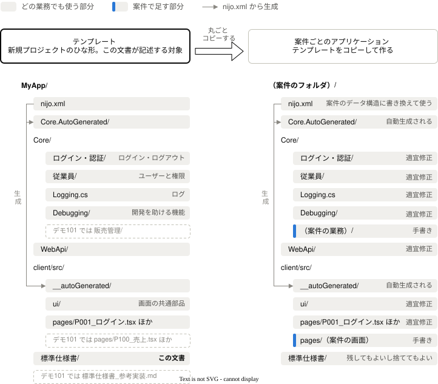

# 標準仕様書

nijo は、アプリケーションのデータ構造と処理を XML ファイル（nijo.xml）に定義し、そこから C# と TypeScript のコードを自動生成するツールである。生成されたコードの上に手書きのコードを追加して、画面・API・DB をもつ業務アプリケーションを作る。

デモ101は、nijo で作った販売管理システムのデモである。デモ101から販売管理に固有の部分を取り除いたものを、新規プロジェクトのひな形（以下、テンプレート）として配布している。新しいアプリケーション（以下、案件）は、次の図のように、テンプレートを丸ごとコピーして作り始める。

案件は、テンプレートの任意の部分を必要に応じて修正し、業務独自の処理や画面を手書きで追加し、実稼働用のアプリケーションとして完成させていく。
テンプレートの振る舞いは基本的にすべて変えられるが、nijo が生成するコードで決まっていて変えられないものが一部存在する。（これに該当する仕様は【自動生成コード由来のため変更不可】と書かれている）

案件はコピー後にテンプレートに入った修正を取り込む義務はない。問題がある場合は独自の責任で改修していく。

## 目次

章ごとにファイルを分けている。本文中の「12.4」「14章」などの番号は、ファイル名の先頭の章番号と対応する。

- [1. この文書について](01_この文書について.md)
- [2. 概要](02_概要.md)
- [3. 実行環境](03_実行環境.md)
- [4. プロジェクトの構成と業務処理の書き方](04_プロジェクトの構成と業務処理の書き方.md)
- [5. 設定](05_設定.md)
- [6. DB とマイグレーション](06_DBとマイグレーション.md)
- [7. データ構造と項目の型](07_データ構造と項目の型.md)
- [8. クライアントの作り](08_クライアントの作り.md)
- [9. クライアントとサーバーの間の取り決め](09_クライアントとサーバーの間の取り決め.md)
- [10. エラーとメッセージ](10_エラーとメッセージ.md)
- [11. 検索](11_検索.md)
- [12. 更新](12_更新.md)
- [13. 外部システム連携](13_外部システム連携.md)
- [14. 認証](14_認証.md)
- [15. 権限](15_権限.md)
- [16. ログ](16_ログ.md)
- [17. セキュリティ](17_セキュリティ.md)
- [18. 通知](18_通知.md)
- [19. ジョブ（未実装）](19_ジョブ.md)
- [20. 添付ファイル（未実装）](20_添付ファイル.md)
- [21. クリーンナップ](21_クリーンナップ.md)
- [22. テスト](22_テスト.md)
- [23. 開発支援機能](23_開発支援機能.md)
- [24. 運用](24_運用.md)
- [付録 この文書の記載ルール](付録_この文書の記載ルール.md)
